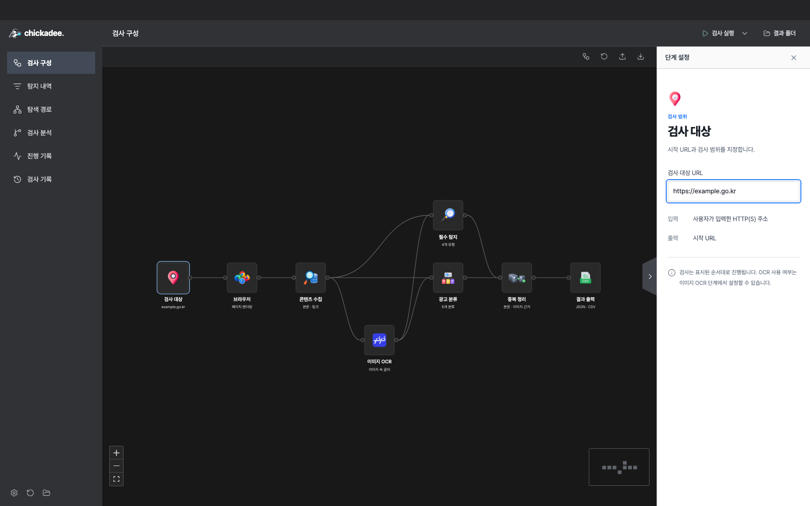
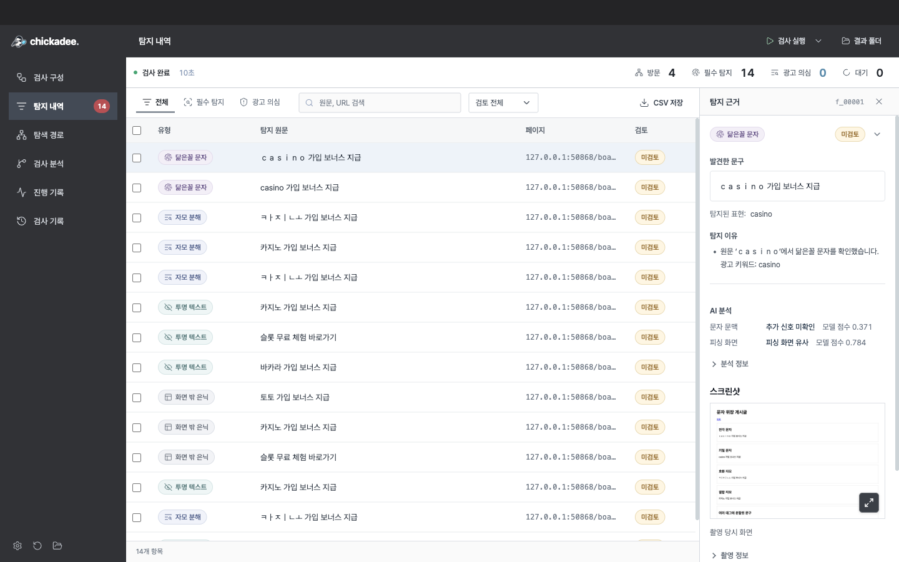
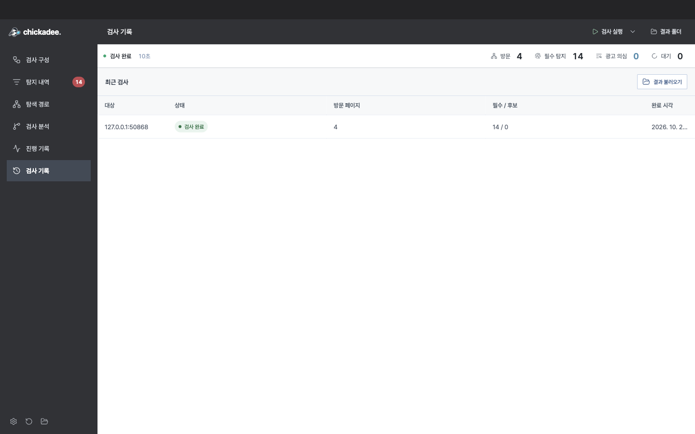

<div align="center">


# Chickadee Studio

[한국어](README.md) · **English**

**Scan websites and review detected text alongside the evidence.**

A desktop tool for finding suspected advertising on public-sector websites.<br />
Enter a URL, inspect pages in a browser, review findings, and export JSON or CSV.

[](https://github.com/orqan137/chickadee_Bot/releases)
[](https://github.com/orqan137/chickadee_Bot/actions/workflows/release.yml)
[](docs/quickstart-windows.md)
[](desktop/package.json)
[](requirements.txt)

[**Download for Windows**](https://github.com/orqan137/chickadee_Bot/releases/tag/v0.8.0) · [Quick start](docs/quickstart-windows.md) · [User manual](docs/manual.md) · [Release notes](docs/releases/0.8.0.md)

</div>

<br />

[](desktop/assets/guide/start.png)

<p align="center"><sub>Select the scan target node to enter a URL. Click any screenshot to view it at full size.</sub></p>

> The app interface, screenshots, and linked documentation are currently primarily in Korean. This English README includes Korean UI labels where useful.

## Get started

**The Windows download includes the app, Python scan engine, and Chromium.** You do not need to install Python, Node.js, or Docker separately.

1. Download the [**0.8.0 Windows ZIP**](https://github.com/orqan137/chickadee_Bot/releases/download/v0.8.0/Chickadee-Studio-0.8.0-win-x64.zip) and extract the entire archive.
2. Run `Chickadee-0.8.0/Chickadee.exe`.
3. Select the **Scan target (검사 대상)** node and enter an address in the URL field on the right.
4. Click **Run scan (검사 실행)** in the top bar. To try the app first, open the adjacent dropdown and select **Demo scan (데모 검사)**.

The local demo works without an internet connection. Open the in-app **User guide (사용 가이드)** for screenshots and step-by-step instructions.

> The current download is a **Windows x64 prerelease**. Keep `Chickadee.exe`, `resources`, and all other bundled files together. macOS supports running from source; a separate macOS download is not available.

## A look inside

### From detected text to review

[](desktop/assets/guide/review.png)

- Use **Findings (탐지 내역)** to separate the required detection categories from suspected advertising, then filter by text, URL, or review status.
- Select a row to see the **detected text and detection reason** on the right.
- Mark a finding as **Reviewed (검토 확인)** or **Excluded (제외)** and add a note. Saved review states persist when you reopen the results.
- Expand **Page · Technical details (페이지 · 기술 정보)** to inspect and copy the URL and DOM location.

### Reopen previous scans

<details>
<summary><strong>View the scan history screen</strong></summary>

[](desktop/assets/guide/history.png)

Select a scan history row to open its results. Use **Import results (결과 불러오기)** to open a separately saved `result.json`, or **Results folder (결과 폴더)** in the top bar to open the output location.

</details>

These screenshots show the current UI running locally. The findings and history screens use the built-in demo; they do not demonstrate detection accuracy on real websites.

## Features

| Feature | What it does |
| --- | --- |
| Node-based scan configuration | Target → browser → content collection → required detections and ad classification → output. Connections and sublink settings affect execution |
| Scan controls | Pause and resume between pages, save partial results after stopping, and rescan individual pages |
| Live browser preview | View Chromium, the current URL, and processing stages in a collapsible panel |
| Navigation and progress logs | Inspect visited and queued URLs, HTTP responses, discovered links, processing stages, and errors |
| Review workflow | Unreviewed, reviewed, and excluded states; notes up to 2,000 characters; batch actions for up to 500 findings |
| Save and restore | JSON, CSV, and reports; restore the last scan view and retain the 30 most recent runs |
| Quick navigation | In-app dropdowns, keyboard menu navigation, quick commands, and remembered settings and node positions |

Core detection is rule-based and requires no external API key or GPU.

### Inspection analysis · 0.8.0

- **Exploration graph**: inspect observed pages, scroll and read actions, and iframe exploration.
- **Change comparison**: compare text, styles, and links against a previous scan of the same URL and select a baseline.
- **Groq review**: after a user starts an analysis, insufficient evidence can trigger follow-up collection of up to two observed same-origin pages and a new assessment. The existing cumulative limit of 6 calls / 24,000 tokens remains. Original findings and human reviews stay unchanged.
- **Evidence screenshots**: view and enlarge the captured viewport in the evidence panel and saved history. Original JPEGs are saved in the result folder's `evidence/` directory and are never sent to Groq.

Advertising review and out-of-site navigation restrictions in the inspection browser are separate from phishing classification or system-wide blocking. A phishing classifier is not included.

See the [inspection analysis guide](docs/inspection-agent.md) for configuration, transmitted evidence, and masking limits.

## What does it detect?

| Required category | Code | Examples |
| --- | --- | --- |
| Look-alike character substitution | `HOMOGLYPH` | Full-width characters, Cyrillic, selected Greek characters, digits, and mixed forms |
| Decomposed Korean characters | `JAMO` | Compatibility and combining jamo, including text split across inline tags |
| Transparent text | `TRANSPARENT` | Transparent colors, element or ancestor opacity, and text matching a solid background |
| Offscreen or hidden text | `OFFSCREEN` | Negative coordinates, 0–1 px text, small boxes with overflow, and hidden elements |

Chickadee inspects the DOM and computed CSS in Chromium. Gambling, loan, investment, and purchase solicitations without obfuscation or concealment are classified separately as **suspected advertising**; they are not arbitrarily assigned a required-category code. Review the original text and supporting evidence together.

<details>
<summary><strong>Crawling scope and behavior</strong></summary>

- Follows same-site links and post query parameters, prioritizing boards and individual posts.
- Handles lazy loading, limited scrolling, site-configured read-only controls, and nested iframes within allowed origins.
- External frame origins must be explicitly configured. Blocked or skipped frames are recorded in the report.
- Applies retries for network errors and 5xx responses, delays between pages, and time and page limits. An HTTP 429 response stops retries and new requests to that origin.
- Does not use your personal Chrome profile or tabs, or insert target-site HTML directly into the Electron display window.
- Detection rules and site settings are replaceable JSON files. Code inside configuration files is not executed.

[Crawling performance and limitations](docs/performance.md) · [Real-site test results](examples/test-site-2026-10-20/)

</details>

## Output files

The default location is `Documents/Chickadee/results/<run-folder>`. You can change it in **Scan settings (검사 설정)**.

| File | Contents |
| --- | --- |
| `result.json` | `meta` and `findings` for the four required categories. Zero findings are represented by an empty array |
| `scan-report.json` | Scan status, visited pages, errors and limits, suspected advertising candidates, and output file hashes |
| `result.csv` | Required-category findings and suspected advertising candidates in a fixed 17-column format |

Stopped, failed, and partial scans are distinguished from successful completion. Review metadata does not overwrite the original detection evidence. See the [CSV column definitions](docs/result-format.md) and [result schema](schemas/result.schema.json).

## Development

The development baseline is Python 3.12 and Node.js 24. These steps are for **running from source**. Users of the Windows download can skip this section.

<details>
<summary><strong>Run from source on Windows</strong></summary>

```powershell
py -3.12 -m venv .venv
.\.venv\Scripts\python.exe -m pip install -r requirements-dev.txt
$env:PLAYWRIGHT_BROWSERS_PATH = '0'
.\.venv\Scripts\python.exe -m playwright install chromium --only-shell
cd desktop
npm ci
npm run build
npm start
```

To package the Windows app and scan engine, use `scripts/build-desktop.ps1` from the repository root. The output executable is `artifacts/electron-0.8.0/win-unpacked/Chickadee.exe`. Distribute the entire output folder.

</details>

<details>
<summary><strong>Run from source on macOS</strong></summary>

```sh
python3.12 -m venv .venv
.venv/bin/python -m pip install -r requirements-dev.txt
PLAYWRIGHT_BROWSERS_PATH=0 .venv/bin/python -m playwright install chromium --only-shell
cd desktop
npm ci
npm run build
npm start
```

`npm start` prepares a development bundle named Chickadee under `artifacts/dev-app/`. Use matching CPU architectures for Electron and the Python virtual environment. A macOS distribution or notarized package is not provided.

</details>

<details>
<summary><strong>Tests and CLI</strong></summary>

```powershell
# Run Python regression tests from the repository root
.\.venv\Scripts\python.exe -m unittest discover -s tests -v

# Run the CLI demo
.\.venv\Scripts\python.exe -m chickadee --demo --cli --output-dir artifacts/demo

# Run desktop unit tests
cd desktop
npm test
```

On macOS, replace the Python executable path with `.venv/bin/python`. See the [manual](docs/manual.md) for the legacy Tkinter interface and CLI, and the [desktop development guide](docs/desktop.md) for desktop builds.

</details>

## Documentation

The linked documents are primarily in Korean.

| Getting started | Development and validation | Research |
| --- | --- | --- |
| [Windows quick start](docs/quickstart-windows.md) | [Desktop development and packaging](docs/desktop.md) | [Research sources](research/README.md) |
| [User manual](docs/manual.md) | [Architecture](docs/architecture.md) | [Dots research integration](docs/research-integration.md) |
| [Output formats](docs/result-format.md) | [Validation log](docs/validation.md) | [Research v4 summary](docs/research-v4.md) |
| [Release notes](docs/releases/0.8.0.md) | [Design guidelines](DESIGN.md) | [ML and agent design](docs/ml-agent-generalization.md) |
| [Development plan](docs/development-plan.md) | [Agent specification](docs/agent-extension.md) | [Offline ML comparison](research/ml-review/2026-10-21/) |
| [Requirements](docs/requirements.md) | [Third-party notices](docs/third-party-notices.md) | [Mock site specification](examples/mock-site-spec.json) |
| [Submission checklist](docs/submission-checklist.md) | [Sample results](examples/result.sample.json) | [Mock site content](examples/mock-site-content.json) |

<details>
<summary><strong>View the architecture diagram</strong></summary>


[Editable source](docs/assets/architecture.drawio)

</details>

## Scope and limitations

Chickadee is being developed for the 2026 public-sector website illegal-advertising detection tool competition. As a rule-based tool, it can produce false positives and miss relevant content. Findings do not constitute a determination of illegality.

- Authentication, image OCR, POST-based comment APIs, Shadow DOM, and exhaustive infinite-scroll collection are not supported.
- The 14 required-category findings in the built-in demo do not represent accuracy on real websites or a private evaluation dataset.
- Research v4 contains 55 suspected advertising cases and 23 benign cases. Static HTML observations are distinguished from rendered-page validation; adding research material does not mean every pattern is successfully detected.
- Windows distribution binaries are not certificate-signed. Local security policies may restrict execution.

See the [validation log](docs/validation.md) for tested scope and outstanding work, and the [requirements](docs/requirements.md) for submission criteria.
