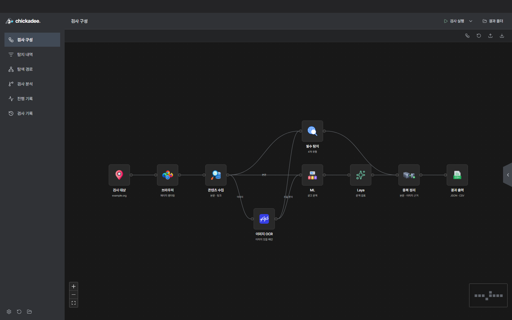
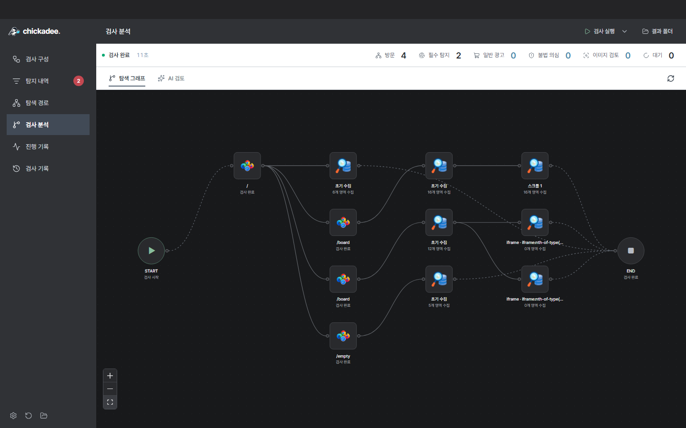

<div align="center">


# Chickadee Studio

**Detect obfuscated and hidden advertising on public-sector websites, inspect evidence, and record reviews.**

[](https://github.com/orqan137/chickadee_studio/releases/latest)
[](https://github.com/orqan137/chickadee_studio/actions/workflows/release.yml)
[](LICENSE)

[**Windows download**](https://github.com/orqan137/chickadee_studio/releases/latest) · [User guide](docs/quickstart-windows.md) · [Output format](docs/result-format.md) · [한국어](README.md)

</div>



## Required detection categories

Chickadee implements the four required techniques in the Korean Public Website Illegal Advertising Detection Tool Development Competition.

| Category | Code | Evidence |
| --- | --- | --- |
| Look-alike characters | `HOMOGLYPH` | Full-width, Cyrillic, similar characters, and digit substitutions |
| Decomposed Korean text | `JAMO` | Separated jamo and text divided across inline tags |
| Transparent text | `TRANSPARENT` | Transparent colors, element/ancestor opacity, and text matching the background |
| Offscreen or hidden text | `OFFSCREEN` | Negative coordinates, 0–1px text, clipping, and hidden elements |

Chromium renders pages to collect source text, DOM locations, computed CSS, and geometry. Advertising context and hiding evidence are assessed together. Additional advertising observations are recorded separately from the four required techniques.

## Get started

1. Download `Chickadee-Studio-<version>-win-x64.zip` from the [latest release](https://github.com/orqan137/chickadee_studio/releases/latest).
2. **Extract the entire ZIP into a new folder** and run `Chickadee.exe`. Keep the bundled `resources` folder together with the app.
3. Enter one starting URL in **검사 대상**, then select **검사 실행**.
4. Inspect source text, locations, and images in **탐지 내역**, and save review states and notes.
5. Open **결과 폴더** to find JSON and CSV output.

The Windows x64 package includes the Python engine, Chromium, Korean OCR, and local ML models. No separate Python, Node.js, Docker, or GPU installation is needed. Use the Run scan dropdown → **데모 검사** to try the bundled offline demonstration. The app interface and most guides are in Korean.

## Competition requirements

| Requirement | Implementation |
| --- | --- |
| One entry URL | Same-site page, post, comment, and iframe exploration |
| Four mandatory techniques | Source text, page URL, CSS location, and technique evidence |
| Results and management UI | Evidence panels, search, filters, review notes, and saved history |
| Evaluation output | UTF-8 without BOM, `result.json` containing `meta` and `findings` |
| Additional findings | Separate `result_extra.json` using `ETC` and `extra_finding` |
| Windows 11, general-purpose PC | CPU/RAM inference with bundled OCR models |
| Development deliverables | Source code, build instructions, user guide, and versioned executable releases |
| External AI configuration | Documented Groq service, model, and external key file; no rebuild for key changes |

See the [requirements](docs/requirements.md) and [submission checklist](docs/submission-checklist.md).

## Inspection and evidence

Text goes directly to ML context analysis. **Only images pass through PaddleOCR before ML.** Without images, the OCR stage displays `이미지 없음`. Image evidence includes the original image, extracted text, bounding boxes, and confidence.


The app shows page previews, activity logs, and observed navigation paths. Cookie-based login can resume through a separate authentication window. Saved results reopen without revisiting the site.



## Output files

Default location: **`Documents/Chickadee/results/<run-folder>/`**. A custom output location also receives separate run folders. Open **결과 폴더** to see the actual path.

| File | Contents |
| --- | --- |
| `result.json` | The four required detection techniques, combined in one `findings` array |
| `result_extra.json` | Additional context observations; review candidates are not automatically confirmed as illegal |
| `result.csv` | Mandatory findings and advertising candidates in 17 fixed columns |
| `scan-report.json` | Status, coverage, errors, OCR/context analysis, and evidence metadata |
| `review.json` | Review states and notes |

The detection unit is `(url, location, technique)`. Multiple techniques on one element produce separate records. Evidence text preserves the original characters. Iframe selectors use `iframe[src="absolute URL"] >>> inner selector`. Empty results still contain `findings: []`.

See the [JSON Schema](schemas/result.schema.json), [output specification](docs/result-format.md), and [first page of the user guide](docs/quickstart-windows.md) for file locations and examples.

## Optional AI review

Core inspection, OCR, and ML work locally without an API key. Additional evidence review uses **Groq** when configured and started by the user. The default model is `openai/gpt-oss-20b`, with limits of **6 requests and 24,000 tokens per scan**.

Enter a key in AI settings or launch `Chickadee.exe --groq-env-file "path to external configuration"`. The file contains `GROQ_API_KEY`; changing the key requires no rebuild. See the [configuration example](.env.example) and [agent guide](docs/inspection-agent.md).

## Run from source

The development baseline is **Python 3.12 and Node.js 24**. Users of the Windows download do not need to install these separately.

```sh
git clone https://github.com/orqan137/chickadee_studio.git
cd chickadee_studio
```

<details>
<summary><strong>macOS</strong></summary>

```sh
python3.12 -m venv .venv
.venv/bin/python -m pip install -r requirements-dev.txt
.venv/bin/python scripts/prepare_ocr_models.py
PLAYWRIGHT_BROWSERS_PATH=0 .venv/bin/python -m playwright install chromium --only-shell
cd desktop
npm ci
npm run build
npm start
```

Use matching CPU architectures for Electron and the Python environment. `npm start` prepares a development app named Chickadee.

</details>

<details>
<summary><strong>Windows PowerShell</strong></summary>

```powershell
py -3.12 -m venv .venv
.\.venv\Scripts\python.exe -m pip install -r requirements-dev.txt
.\.venv\Scripts\python.exe scripts/prepare_ocr_models.py
$env:PLAYWRIGHT_BROWSERS_PATH = '0'
.\.venv\Scripts\python.exe -m playwright install chromium --only-shell
cd desktop
npm ci
npm run build
npm start
```

Run `./scripts/build-desktop.ps1` from the repository root to package the app. Output is in `artifacts/electron-<version>/win-unpacked/`.

</details>

## Documentation

[User guide](docs/quickstart-windows.md) · [Desktop features](docs/desktop.md) · [Requirements](docs/requirements.md) · [Architecture](docs/architecture.md) · [Validation](docs/validation.md) · [Contributing](CONTRIBUTING.md)

## License

[Apache License 2.0](LICENSE). Third-party components and models retain their respective licenses; see [third-party notices](docs/third-party-notices.md).
