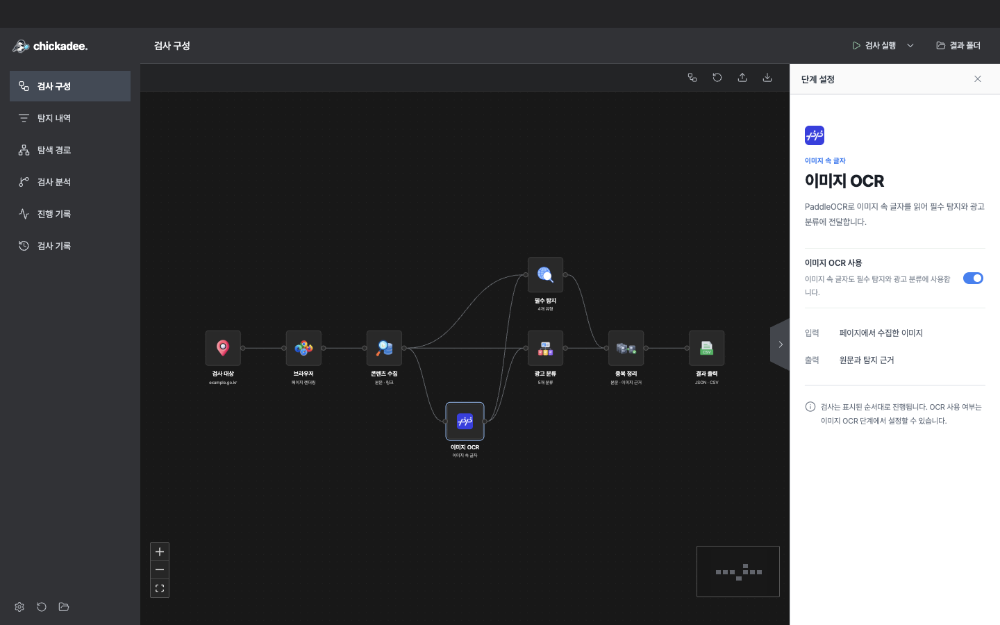
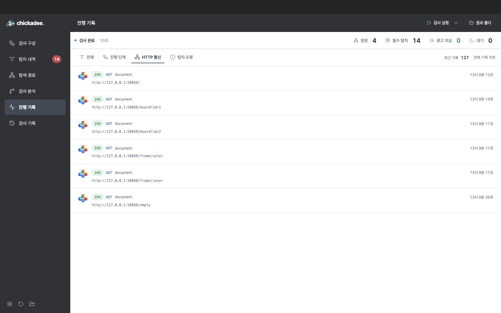
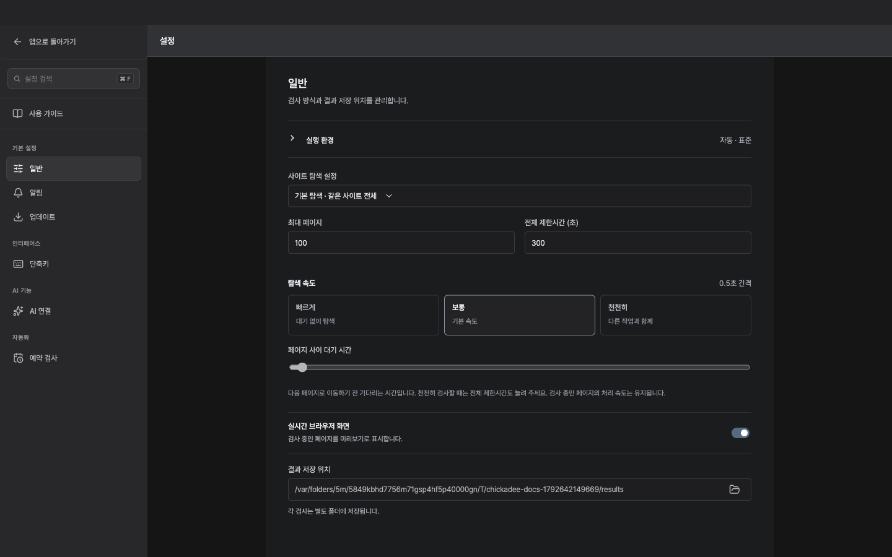
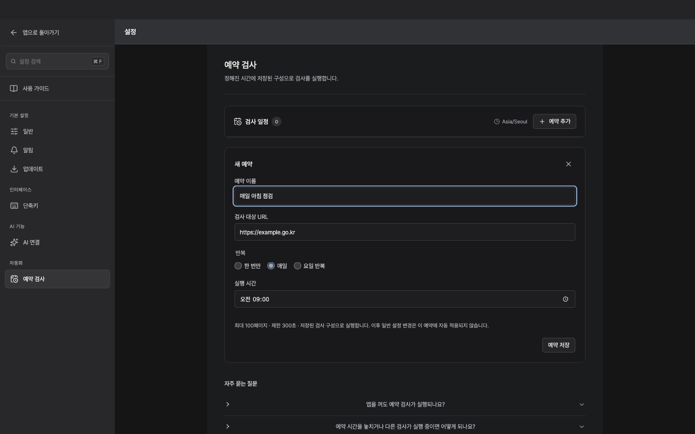
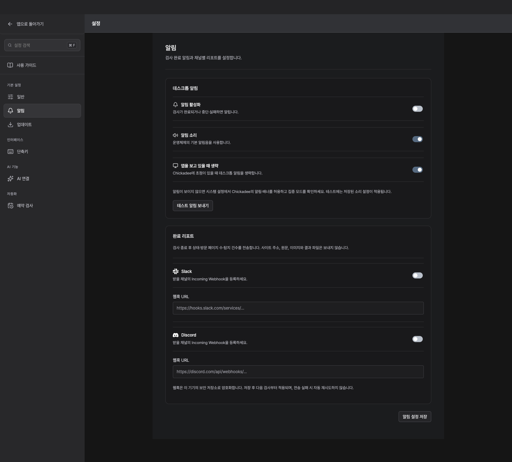
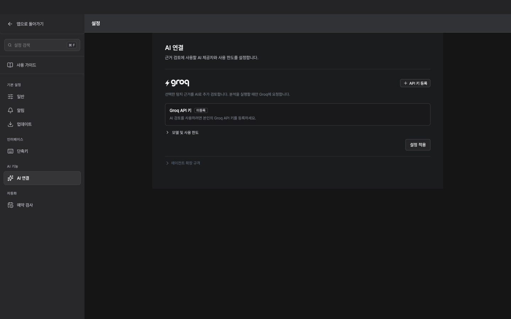
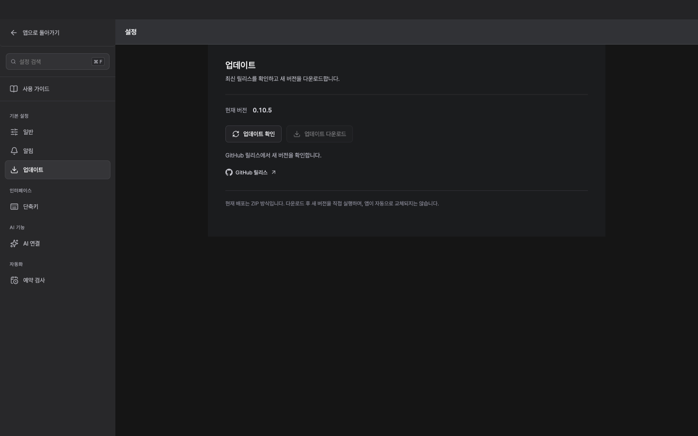
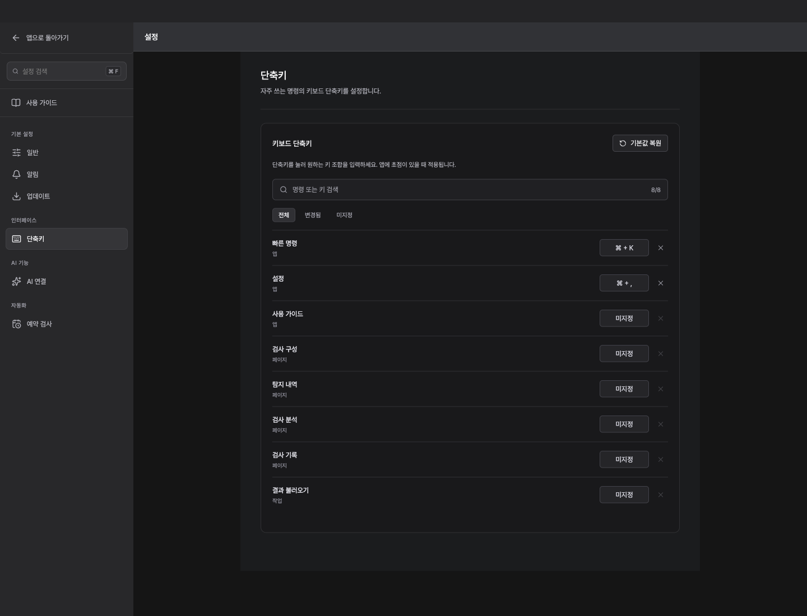
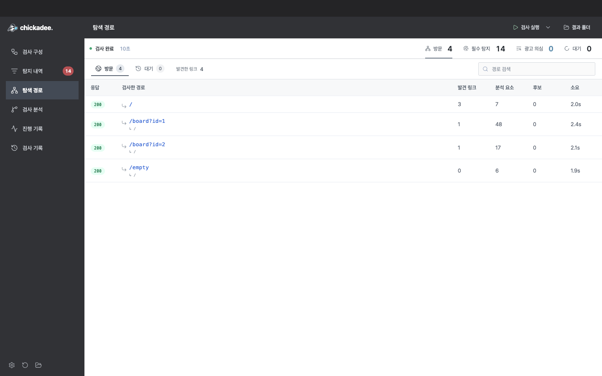
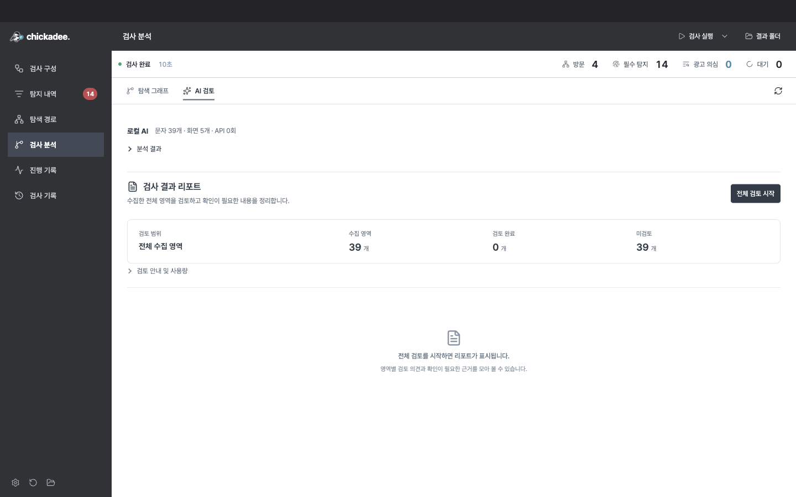

<div align="center">


# Chickadee Studio

**Find suspicious website content. Inspect the evidence. Record your review.**

Browser collection · Korean image OCR · Detection evidence · AI review

[](https://github.com/orqan137/chickadee_studio/releases/latest)
[](https://github.com/orqan137/chickadee_studio/actions/workflows/release.yml)
[](LICENSE)
[](docs/quickstart-windows.md)
[](desktop/package.json)
[](requirements.txt)

[**Download**](https://github.com/orqan137/chickadee_studio/releases/latest) · [User guide](docs/desktop.md) · [Report a bug](https://github.com/orqan137/chickadee_studio/issues) · [Contribute](CONTRIBUTING.md)

[한국어](README.md) · **English**

</div>


<p align="center"><sub>Actual desktop screenshots from version 0.10.5 using the bundled demo. These illustrate the UI, not real-site detection accuracy.</sub></p>

## What is Chickadee?

Chickadee Studio is an open-source desktop tool for inspecting suspected advertising, obfuscated characters, and hidden text on public-sector websites and message boards. It uses Chromium to collect pages and analyze the DOM, computed CSS, and text inside images. Findings include source text, locations, and screenshots for human review.

**Core inspection, PaddleOCR, and local AI run without an external API key.** External AI review requires separate configuration and a user-initiated action. Findings support review; they are not a final determination.

The app interface, screenshots, and most linked documents are currently in Korean.

## Get started

1. Download `Chickadee-Studio-<version>-win-x64.zip` from the [latest Windows release](https://github.com/orqan137/chickadee_studio/releases/latest).
2. **Extract the entire archive** and run `Chickadee.exe`. The app, Python engine, Chromium, and models are bundled.
3. Select **Scan target (검사 대상)**, enter a URL, and click **Run scan (검사 실행)**.
4. Open **Findings (탐지 내역)**, inspect the evidence, and save your review.

To try it offline, open the dropdown next to Run scan and choose **Demo scan (데모 검사)**.

> The download is an **unsigned Windows x64 ZIP**. Keep all bundled files and folders together. macOS can run from source; a packaged macOS download is not provided.

[Windows quick start](docs/quickstart-windows.md) · [Settings and usage](docs/desktop.md) · [Release notes](https://github.com/orqan137/chickadee_studio/releases)

## Features

| | Capability |
| --- | --- |
| **Browser inspection** | Collect same-site links, posts, DOM, computed CSS, and content revealed by scrolling. |
| **Image OCR** | Read Korean image text with PaddleOCR. Failed or skipped OCR is distinguished from no findings. |
| **Evidence review** | Inspect source text, DOM locations, image evidence, and screenshots; save reviewed/excluded states and notes. |
| **Login handoff** | Pause when a login screen is detected, authenticate in a separate window, and resume the original page. |
| **Inspection analysis** | Explore the observed path from START, optionally request external AI review, and export a report. |
| **Automation** | Set the crawl pace and schedules; receive desktop or Slack/Discord webhook completion notifications. |
| **Saved results** | Export JSON/CSV, retain scan history, and reopen results to continue reviewing. |

## Screenshots

### Findings and evidence


Select an item to open its evidence. Required detection categories and suspected advertising remain separate, with review states recorded after you inspect the source.

### Inspection analysis


Explore observed pages and collection actions. External AI review runs in a separate tab and does not overwrite original findings or human review states.

<details>
<summary><strong>Configuration, OCR, and HTTP activity</strong></summary>

**Target configuration**


**Image OCR**



**HTTP activity**



</details>

<details>
<summary><strong>Settings, schedules, and notifications</strong></summary>













</details>

<details>
<summary><strong>History, navigation, and AI review</strong></summary>






</details>

## Detection scope

| Category | Code | Evidence |
| --- | --- | --- |
| Look-alike characters | `HOMOGLYPH` | Mixed full-width, Cyrillic, selected Greek characters, digits, and similar substitutions |
| Decomposed Korean text | `JAMO` | Separated jamo and text split across inline tags |
| Transparent text | `TRANSPARENT` | Transparent colors, element/ancestor opacity, and text matching a solid background |
| Offscreen or hidden text | `OFFSCREEN` | Negative coordinates, tiny text, clipped regions, and hidden elements |

Gambling, loan, investment, and purchase solicitations without obfuscation are separate **suspected advertising** candidates. Blocked, authentication-required, limited, or failed collection is distinguished from successful completion.

Login handoff supports cookie-based authentication. Popup or browser-storage authentication and nonstandard login URLs may not be handled automatically. Chickadee does not use your personal Chrome profile; login cookies remain in memory for the current scan only.

[Crawling scope and limits](docs/performance.md) · [AI review and transmitted data](docs/inspection-agent.md) · [Output formats](docs/result-format.md)

## Run from source

The development baseline is **Python 3.12 and Node.js 24**. Users of the Windows download do not need to install these separately.

```sh
git clone https://github.com/orqan137/chickadee_studio.git
cd chickadee_studio
```

<details>
<summary><strong>macOS</strong></summary>

```sh
python3.12 -m venv .venv
.venv/bin/python -m pip install -r requirements-dev.txt
.venv/bin/python scripts/prepare_ocr_models.py
PLAYWRIGHT_BROWSERS_PATH=0 .venv/bin/python -m playwright install chromium --only-shell
cd desktop
npm ci
npm run build
npm start
```

Use matching CPU architectures for Electron and the Python environment. `npm start` prepares a development app named Chickadee.

</details>

<details>
<summary><strong>Windows PowerShell</strong></summary>

```powershell
py -3.12 -m venv .venv
.\.venv\Scripts\python.exe -m pip install -r requirements-dev.txt
.\.venv\Scripts\python.exe scripts/prepare_ocr_models.py
$env:PLAYWRIGHT_BROWSERS_PATH = '0'
.\.venv\Scripts\python.exe -m playwright install chromium --only-shell
cd desktop
npm ci
npm run build
npm start
```

Run `./scripts/build-desktop.ps1` from the repository root to package the app. Output is in `artifacts/electron-<version>/win-unpacked/`.

</details>

## Contributing

Contributions to detection rules, bug fixes, UI, documentation, and translations are welcome.

- Describe reproduction steps and expected behavior in an [issue](https://github.com/orqan137/chickadee_studio/issues).
- Keep changes focused and include relevant test results in your PR.
- Use actual app screenshots and remove personal information, API keys, cookies, and webhook addresses.

See the [contribution guide](CONTRIBUTING.md) for development, testing, and screenshot capture instructions. To refresh documentation images from the real app:

```sh
npm --prefix desktop run build
node desktop/tests/capture-docs.cjs
```

## Documentation and layout

| Users | Developers |
| --- | --- |
| [Windows quick start](docs/quickstart-windows.md) | [Contribution guide](CONTRIBUTING.md) |
| [Desktop guide](docs/desktop.md) | [Architecture](docs/architecture.md) |
| [Inspection and AI review](docs/inspection-agent.md) | [Validation record](docs/validation.md) |
| [Output formats](docs/result-format.md) | [Third-party notices](docs/third-party-notices.md) |
| [CLI and legacy UI](docs/manual.md) | [Research materials](research/README.md) |

```text
chickadee/       Python engine, OCR, and detection rules
desktop/        Electron app, React UI, and desktop tests
  tests/        Native app verification and documentation captures
scripts/        Model preparation, packaging, and release checks
tests/          Python regression tests and local fixtures
docs/           Usage, architecture, and release notes
```

## License

[Apache License 2.0](LICENSE). Third-party components and models retain their respective licenses; see the [third-party notices](docs/third-party-notices.md).
