<div align="center">


# Chickadee Studio

**Images as images. Text as text.**<br />
**Your chickadee for finding hidden advertising.**

An open-source desktop app for detecting text obfuscation, hidden advertising and promotional text inside images on public-sector websites.

[](https://github.com/orqan137/chickadee_studio/releases/latest)
[](https://github.com/orqan137/chickadee_studio/actions/workflows/release.yml)
[](LICENSE)

[**Windows download**](https://github.com/orqan137/chickadee_studio/releases/latest) | [User guide](docs/quickstart-windows.md) | [Feature guide](docs/features.md) | [한국어](README.md)

</div>


<p align="center">
 Python &nbsp;
 Electron &nbsp;
 React &nbsp;
 PaddleOCR &nbsp;
 Laya / PyTorch &nbsp;
 Groq
</p>

| OCR | ML | Laya |
| --- | --- | --- |
| Extract Korean text and boxes from images | Classify text context with TF-IDF and RF | Review context with a fully fine-tuned Korean CPU model |

## Contents

1. [Installation](#1-installation)
2. [Processing pipeline](#2-processing-pipeline)
3. [Features](#3-features)
4. [Service stages](#4-service-stages)
5. [Output files](#5-output-files)
6. [Datasets](#6-datasets)
7. [Training and evaluation](#7-training-and-evaluation)
8. [Development](#8-development)
9. [Documentation and contributions](#9-documentation-and-contributions)
10. [License](#10-license)

## 1. Installation

1. Download `Chickadee-Studio-<version>-win-x64.zip` from the [latest release](https://github.com/orqan137/chickadee_studio/releases/latest).
2. Extract the **entire ZIP** into a new folder and run `Chickadee.exe`. Keep the bundled `resources` folder together with the app.
3. Enter a starting URL and select **검사 실행**.
4. Inspect source text, locations and screenshots in **탐지 내역**, then save review states and notes.
5. Open **결과 폴더** for JSON, CSV and reports.

The Windows x64 package includes Python, Chromium, Korean OCR and local ML models. No separate Python, Node.js, Docker or GPU installation is needed. The Run scan dropdown → **데모 검사** opens the bundled offline demonstration. The interface and detailed guides are in Korean.

Core scanning, OCR, RF and Laya inference run locally without an API key. Laya requires the separately installed [Korean model pack](https://github.com/orqan137/chickadee_studio/releases/tag/laya-ko-v1) and CPU runtime. Groq review is optional and uses a user-provided key.

## 2. Processing pipeline


The figure describes the overall design. In the current release, **text bypasses OCR**, Laya runs on CPU with the installed Korean model pack, and results are stored as local files.

| Stage | Processing |
| --- | --- |
| Collection | Same-site pages, posts, comments, iframes, DOM, computed CSS and images |
| Text inspection | Original characters, decomposed Korean text, visibility and coordinates |
| Image OCR | PaddleOCR only when images are present; recognized text, boxes and confidence |
| Local analysis | TF-IDF and RF for text; image features as a separate supporting signal |
| Consolidation | Deduplicated observations with original text, URLs, locations and screenshots |
| Optional Groq review | Evidence lookup and bounded follow-up through observed same-site links |
| Export | JSON, CSV, standalone HTML and Markdown |

Without images, the OCR node displays **이미지 없음**. OCR extracts text; rules and ML analyze advertising context. OCR output alone does not establish which Unicode characters appeared in the original image.

[Architecture](docs/architecture.md) | [Exploration and AI settings](docs/inspection-agent.md)

## 3. Features

### 3.1 Website and comment exploration

A single URL starts exploration of pages, posts, comments and iframes on the same site. The app shows navigation paths, queued URLs, HTTP status and activity logs. A separate authentication window supports login and scan resumption. Pause, resume, stop and page previews are available during scanning.

Delayed comments and configured read-only **load more** controls are covered by a Chromium integration test. Site-specific controls may require a scan profile. Page and time limits produce explicitly marked partial results.

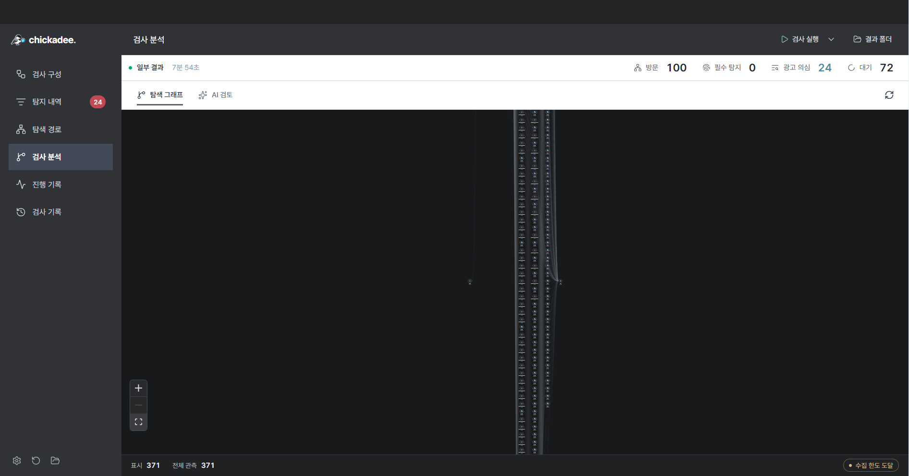

The example contains 371 observed nodes from a 100-page scan. START and END are interface markers.

### 3.2 Text obfuscation and hiding detection

| Technique | Code | Signals |
| --- | --- | --- |
| Look-alike characters | `HOMOGLYPH` | Cyrillic, full-width and other character substitutions |
| Decomposed Korean | `JAMO` | Separated jamo and text split across inline tags |
| Transparent text | `TRANSPARENT` | Transparent color, ancestor opacity and matching background color |
| Offscreen or hidden text | `OFFSCREEN` | Negative coordinates, tiny text, clipping and hidden elements |

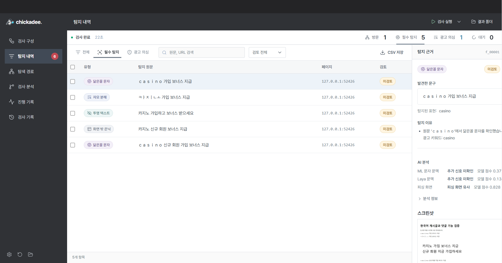

Original text and element locations are preserved. Advertising context without one of these techniques is recorded separately.

### 3.3 Korean image OCR

PaddleOCR extracts Korean text and links each line to its original image, bounding box and confidence. Selecting a line highlights its position. Repeated images use a cache; unreadable, failed and omitted processing states remain distinct.

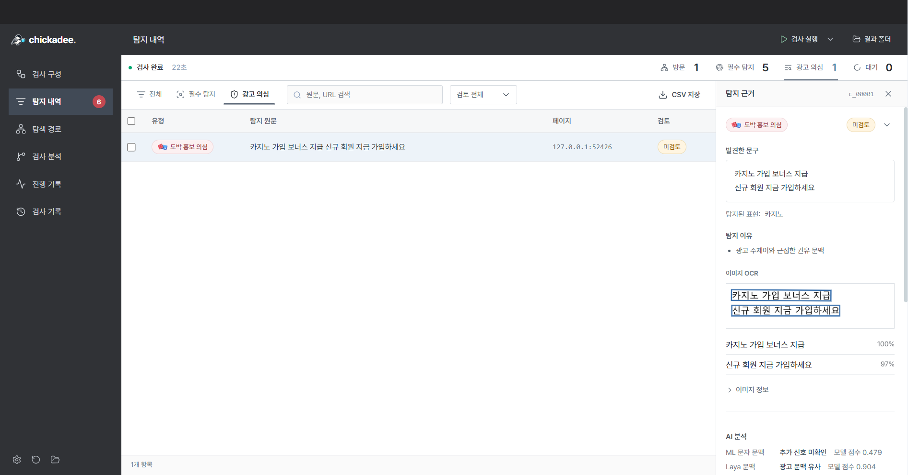

This is a functional validation image, not a population-level accuracy measurement.

The local backend also exposes `content.analyze` for direct image/text analysis, preserving the distinction between supplied text and OCR output. [Request and response format](docs/content-analysis.md)

### 3.4 Local analysis and Laya integration

The bundled RF analyzes source text and OCR text to prioritize review. The statistics view shows processing counts and score distributions. The recorded local scan processed 8 Laya contexts and 1 Korean OCR image without API calls. Scores are not accuracy or legal-violation probabilities.

An optional **local CPU Laya review worker** is already connected to the pipeline. It requires an explicitly installed, independently evaluated model bundle and compatible runtime. It does not download weights or make API calls. The Korean model pack has completed a separate 12-sample diagnostic evaluation and was run in the desktop pipeline. The app reads the installed local model configuration automatically. [Model pack](https://github.com/orqan137/chickadee_studio/releases/tag/laya-ko-v1). [Local analysis configuration](docs/content-analysis.md)

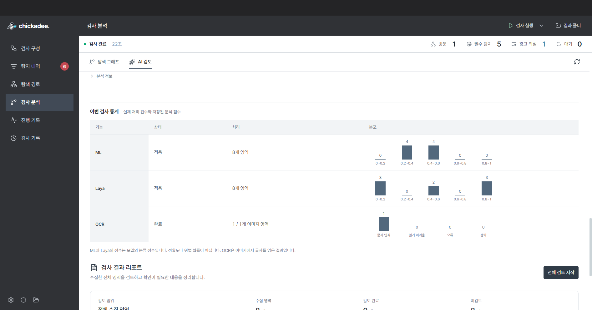

### 3.5 Optional Groq review

Select **전체 검토 시작** to review collected evidence. Groq prioritizes promotional context and may inspect a small number of already discovered same-site links when evidence is insufficient. Existing findings and human reviews are preserved.

| Setting | Default |
| --- | --- |
| Provider | Groq |
| Model | `openai/gpt-oss-20b` |
| Per-scan limit | 6 cumulative requests and 24,000 tokens |
| Key input | Password field in AI settings |
| External key file | `GROQ_API_KEY`, selected through `--groq-env-file` |

Keys are not stored in scan results or reports. Partial reviews and unreviewed counts are preserved when limits are reached.

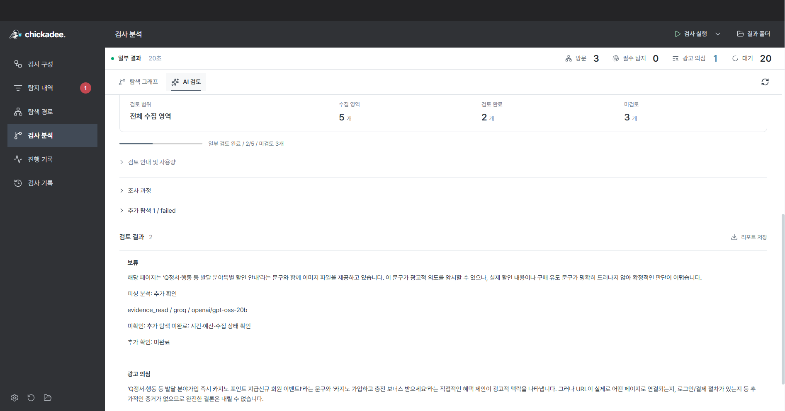

The example used 5 requests and 6,165 tokens: 2 reviewed items and 3 unreviewed items out of 5 collected items.

### 3.6 Review and history

Inspect source text, URLs, CSS selectors and screenshots; search, filter, add notes and update review states individually or in bulk. Saved scans reopen without revisiting the website. Screenshots preserve the observed viewport; transparent or offscreen text also requires source and CSS inspection.

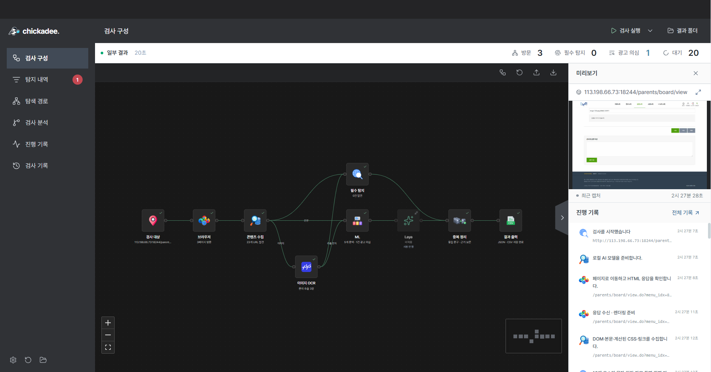

### 3.7 Settings and productivity

Configure execution mode, output location, completion notifications and scheduled scans. Scheduling requires the app to remain open; external notification channels require user configuration. Shortcuts, Ctrl K commands and release updates are available in settings.

[All feature screenshots](docs/features.md)

## 4. Service stages

Clips show the actual app. Korean OCR and Laya use a local validation page; Groq opinions are reopened from a separate saved website scan. Rerecording made no API calls.

### 01. Target URL

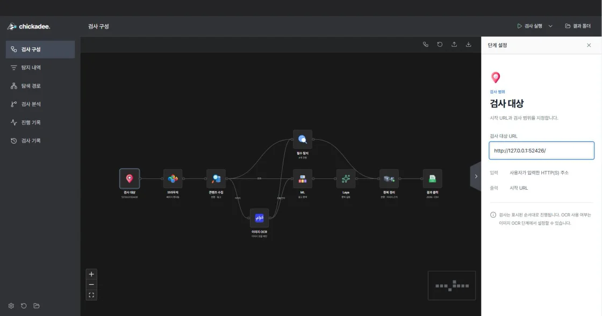

### 02. Posts and comments

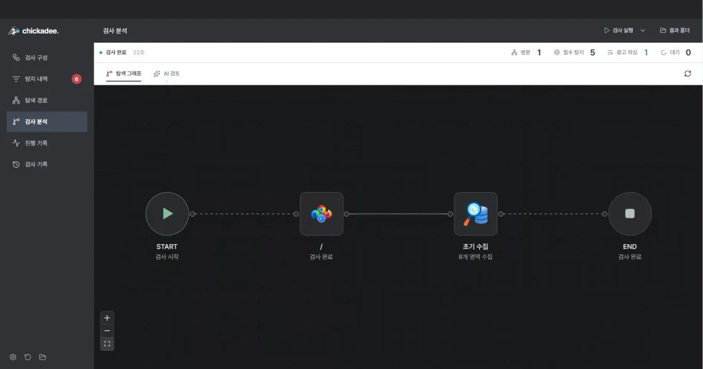

### 03. Obfuscation and hidden text

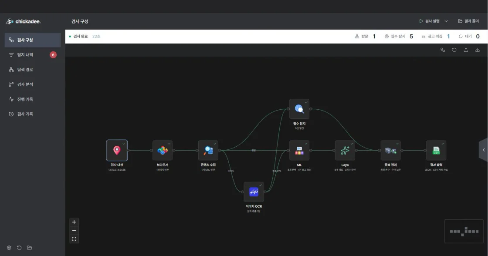

### 04. Image text extraction

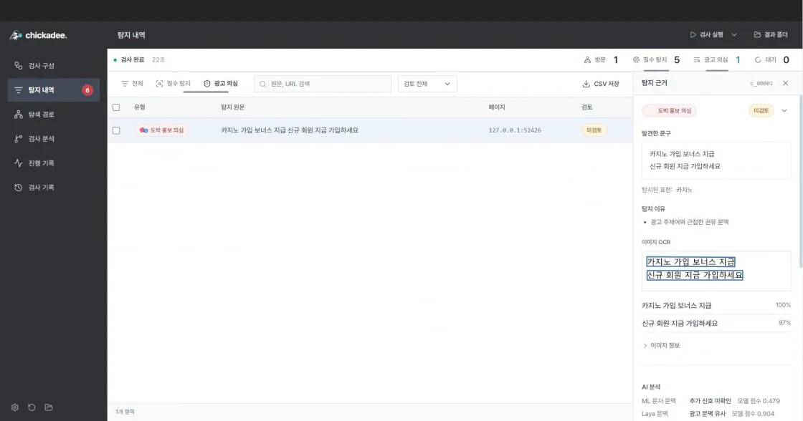

### 05. RF and Laya analysis

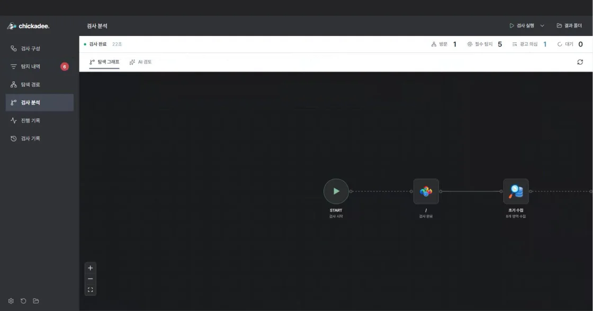

### 06. Groq review

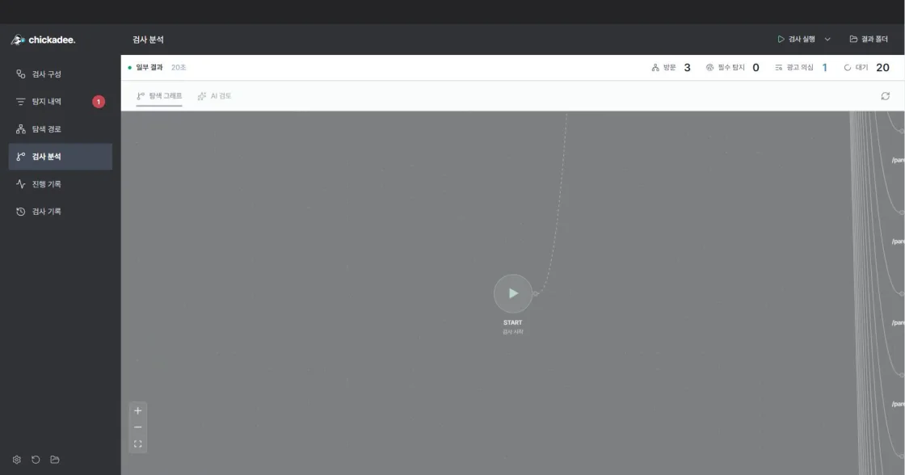

### 07. Review and reports

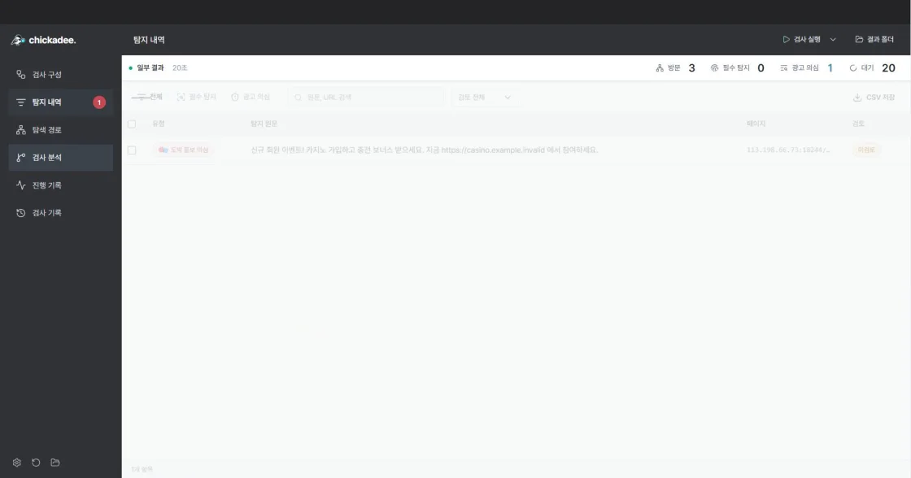

[Full recording](docs/assets/demos/service.webm) | [GIF version](docs/assets/demos/overview.gif)

## 5. Output files

Default location: **`Documents/Chickadee/results/<run-folder>/`**. A custom output location also receives separate run folders. Open **결과 폴더** to see the actual path.

| File | Contents |
| --- | --- |
| `result.json` | Four obfuscation/hiding techniques in `meta` and `findings` |
| `result_extra.json` | Additional advertising observations using `ETC` and `extra_finding` |
| `result.csv` | Findings and advertising candidates in 17 fixed columns |
| `scan-report.json` | Status, coverage, errors, DOM/CSS, OCR and local analysis |
| `review.json` | Human review states and notes |
| `agent.json` | Groq opinions, follow-up exploration and cumulative usage |
| `events.jsonl` | Scan progress events |
| `review-report.html` | Standalone report with embedded screenshots |
| `review-report.md` | Markdown report |
| `evidence/` | Captured viewport images |

JSON uses UTF-8 without BOM. `result.json` combines every page in one `findings` array, including an empty array for zero findings. The detection unit is `(url, location, technique)`. Evidence text preserves the original characters. Multiple techniques on one element produce separate records; iframe locations use `iframe[src="absolute URL"] >>> inner selector`.

HTML reports work offline and can be printed to PDF. Partial or interrupted runs retain their status and unreviewed counts.

[JSON and CSV specification](docs/result-format.md) | [JSON Schema](schemas/result.schema.json) | [HTML example](docs/assets/demos/sample-report.html) | [CSV example](docs/assets/demos/sample-results.csv)

## 6. Datasets

### 6.1 Public sources

| Source | Use |
| --- | --- |
| [Korean YouTube bot comments](https://huggingface.co/datasets/MisileLab/youtube-bot-comments-v2), MIT | Adult/gambling promotional comments versus normal comments in the text comparison |
| [Korean smishing messages](https://huggingface.co/datasets/jmjmjm3/kor-smishing-message), CC BY-NC-SA 4.0 | Additional candidate collection and deduplication; excluded from the comparison below |
| [Ko-ToxicWebQ](https://github.com/kimjeyoung/Ko-ToxicWebQ) | Korean harmful-topic and expression references, distinguished from actual advertisement labels |
| [Adult content dataset](https://figshare.com/articles/dataset/Adult_content_dataset/13456484), MIT | Image-topic experiments, separate from OCR and legal advertising labels |
| [PaddleOCR](https://github.com/PaddlePaddle/PaddleOCR) | Official pretrained Korean recognition models |
| Public regulator cases | Advertisement captures and quotations, separated from ordinary reporting |

### 6.2 Content taxonomy

The collection and review taxonomy covers: sexual advertising, gambling, drugs, illegal finance, fraud, illegal medical advertising, illegal medicine sales, illegal entertainment services, youth-harmful advertising, illegal recruitment, personal-data trading, illegal goods, false or exaggerated advertising, and illegal digital services.

The shipped detector covers the four obfuscation/hiding techniques and advertising-context review. The taxonomy does not establish validated supervised classification across all 14 topics.

### 6.3 Preparation and splitting

Preserve source URLs, hashes and original label meanings; separate actual advertisements, quotations, normal reporting and synthetic text; screen normalized duplicates and similar text; group source documents and campaigns; freeze train, validation, calibration and test partitions; keep new independent evaluation material out of training and threshold adjustment.

The additional smishing collection started with 18,270 rows, removed 4,058 normalized duplicates and quarantined 41 groups for conflicts or unsuitable text. The remaining 14,171 candidates are not treated as 14-topic advertising ground truth. Crops from one document are not counted as independent advertisements.

Raw training data is stored separately. The app and model-pack releases provide runtime models and notices. Source-specific usage conditions apply.

## 7. Training and evaluation

### 7.1 Korean context classification

The comparison used 440 real training texts and 49 synthetic augmentations. Results below describe a **fixed evaluation set of 118 normal/promotional bot comments**, not independent operational performance or 14-topic legal classification.

| Model | Accuracy | Macro F1 | Promotional recall | Normal-text false-positive rate |
| --- | ---: | ---: | ---: | ---: |
| RF | 86.44% | 0.8619 | 72.88% | 0.00% |
| RF with augmentation | 87.29% | 0.8708 | 74.58% | 0.00% |
| Full BERT fine-tuning | 88.98% | 0.8892 | 81.36% | 3.39% |
| Full Laya fine-tuning | 95.76% | 0.9576 | 93.22% | 1.69% |

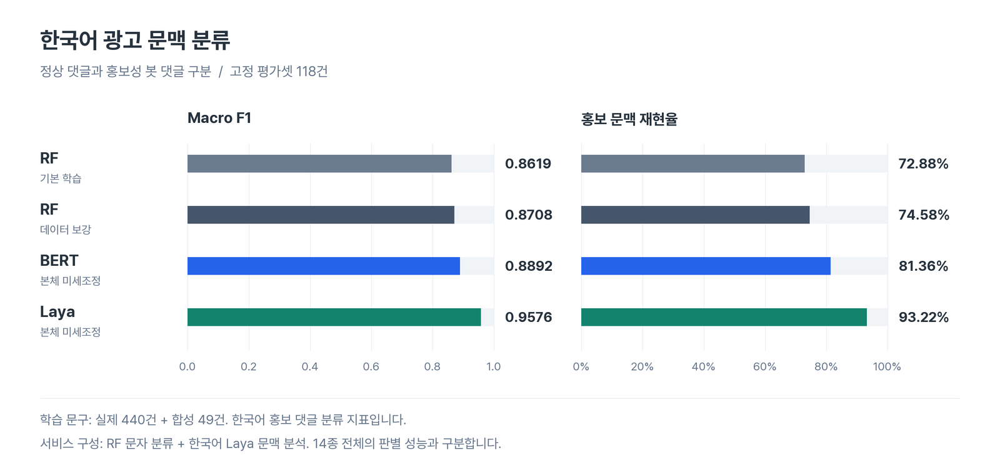

A separate diagnostic set contains 7 advertisements and 5 normal reporting samples from 5 new sources. Baseline RF detected 0/7 advertisements and augmented RF detected 1/7. Six advertisement samples require source context beyond their text. Full fine-tuned Laya detected 4/7 advertisements and preserved 5/5 normal reports, with 9/12 total agreement. Production-worker predictions matched evaluation probabilities within 0.000001 on these 12 samples.

### 7.2 OCR recognition

These Latin-script recognition metrics cover 43 text regions from 16 real images. They are not a Korean-language performance benchmark. Reference text was transcribed directly from the images.

| Model | Character errors | CER | Deployment |
| --- | ---: | ---: | --- |
| Existing OCR | 13 / 1,229 | 1.06% | Existing Korean model retained |
| Further-trained OCR | 36 / 1,229 | 2.93% | Not promoted |

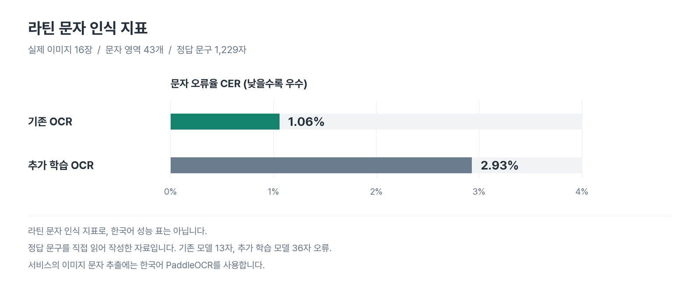

Separate Korean fixtures verify extraction, coordinates and UI rendering; these are functional checks rather than a Korean accuracy benchmark.

### 7.3 Deployment and verification

The app uses Korean PaddleOCR, RF and the installed Korean Laya model pack. Laya is available as an installed local CPU model pack. BERT is retained as an evaluation reference. Groq runs only when configured and requested.

[Windows package verification](https://github.com/orqan137/chickadee_studio/actions/runs/39824971344) covers extraction, launch, Korean OCR, image-free processing, login resumption and key registration. Published-file checksums, included models, ordinary Windows launch, report saving/reopening, review persistence and CSV export were also checked.

[Metrics and split hashes](docs/assets/evaluation/metrics.json) | [Test guide](docs/validation.md)

## 8. Development

Development baseline: **Python 3.12 and Node.js 24**. Windows download users do not need this setup.

```sh
git clone https://github.com/orqan137/chickadee_studio.git
cd chickadee_studio
```

<details>
<summary><strong>Windows PowerShell</strong></summary>

```powershell
py -3.12 -m venv .venv
.\.venv\Scripts\python.exe -m pip install -r requirements-dev.txt
.\.venv\Scripts\python.exe scripts/prepare_ocr_models.py
$env:PLAYWRIGHT_BROWSERS_PATH = '0'
.\.venv\Scripts\python.exe -m playwright install chromium --only-shell
cd desktop
npm ci
npm run build
npm start
```

Run `./scripts/build-desktop.ps1` from the repository root to package the app. Output is in `artifacts/electron-<version>/win-unpacked/`.

</details>

<details>
<summary><strong>macOS</strong></summary>

```sh
python3.12 -m venv .venv
.venv/bin/python -m pip install -r requirements-dev.txt
.venv/bin/python scripts/prepare_ocr_models.py
PLAYWRIGHT_BROWSERS_PATH=0 .venv/bin/python -m playwright install chromium --only-shell
cd desktop
npm ci
npm run build
npm start
```

Match Electron and Python CPU architectures.

</details>

The app shell is in `desktop/`, the engine in `chickadee/`, and output schemas in `schemas/`. Regenerate figures from public metrics with `python scripts/render_evaluation_charts.py` after installing desktop dependencies.

## 9. Documentation and contributions

[User guide](docs/quickstart-windows.md) | [Feature screenshots](docs/features.md) | [Desktop guide](docs/desktop.md) | [Architecture](docs/architecture.md) | [Output format](docs/result-format.md) | [AI configuration](docs/inspection-agent.md) | [Tests](docs/validation.md) | [Contributing](CONTRIBUTING.md)

Report reproducible bugs and propose features through [GitHub Issues](https://github.com/orqan137/chickadee_studio/issues). Do not post API keys or login credentials.

## 10. License

[Apache License 2.0](LICENSE). Third-party libraries, fonts and models retain their respective licenses; see [third-party notices](docs/third-party-notices.md).
