<div align="center">


# Chickadee Studio

**이미지는 이미지대로, 글은 글대로.**<br />
**숨어 있는 광고를 찾아주는 당신의 박새, 치카디.**

공공 웹사이트의 문자 위장과 화면 은닉을 탐지하고, 이미지 속 광고 문구까지 분석하는 오픈소스 데스크톱 앱입니다.

[](https://github.com/orqan137/chickadee_studio/releases/latest)
[](https://github.com/orqan137/chickadee_studio/actions/workflows/release.yml)
[](LICENSE)
[](docs/quickstart-windows.md)

[**Windows 다운로드**](https://github.com/orqan137/chickadee_studio/releases/latest) | [사용설명서](docs/quickstart-windows.md) | [기능 안내](docs/features.md) | [English](README.en.md)

</div>


## 목차

1. [설치 및 실행](#1-설치-및-실행)
2. [검사 처리 구조](#2-검사-처리-구조)
3. [주요 기능](#3-주요-기능)
4. [기능 시연](#4-기능-시연)
5. [출력 파일](#5-출력-파일)
6. [데이터 구성](#6-데이터-구성)
7. [학습 및 평가](#7-학습-및-평가)
8. [개발 환경](#8-개발-환경)
9. [문서 및 기여](#9-문서-및-기여)
10. [라이선스](#10-라이선스)

## 1. 설치 및 실행

1. [최신 릴리스](https://github.com/orqan137/chickadee_studio/releases/latest)에서 `Chickadee-Studio-<버전>-win-x64.zip`을 내려받습니다.
2. ZIP 전체를 새 폴더에 압축 해제한 뒤 `Chickadee.exe`를 실행합니다. 동봉된 `resources` 폴더를 함께 유지합니다.
3. **검사 대상**에 URL을 입력하고 **검사 실행**을 누릅니다.
4. **탐지 내역**에서 원문과 위치를 확인하고 검토 상태와 메모를 저장합니다.
5. **결과 폴더**에서 JSON, CSV와 보고서를 확인합니다.

Windows x64 실행본에는 Python 검사 엔진, Chromium, 한국어 OCR과 로컬 ML 모델이 포함됩니다. Python, Node.js, Docker, GPU를 별도로 설치할 필요가 없습니다. **검사 실행 옆 펼침 메뉴 → 데모 검사**에서는 인터넷 없이 내장 예제를 확인할 수 있습니다.

| 구분 | 실행 방식 |
| --- | --- |
| 웹페이지 검사 | URL 입력 후 같은 사이트 탐색 |
| 이미지 문자 추출 | PC에서 한국어 PaddleOCR 실행 |
| 광고 문맥 분석 | PC에서 TF-IDF와 Random Forest 실행 |
| Groq 추가 검토 | 사용자 API 키 등록 후 선택 실행 |

## 2. 검사 처리 구조


이미지는 이미지대로, 글은 글대로. 수집한 자료의 형태에 맞춰 처리하고 원문과 위치를 함께 보존합니다.

위 그림은 전체 설계 개요입니다. 현재 배포본의 처리 경로와 적용 상태는 다음과 같습니다. 본문 텍스트는 OCR을 거치지 않으며, Laya는 비교 실험 단계입니다. 결과는 로컬 파일로 저장합니다.

| 단계 | 처리 내용 | 다음 단계 |
| --- | --- | --- |
| 웹페이지 수집 | 진입 URL에서 본문, DOM, 계산된 CSS, 좌표와 이미지 수집 | 문자 분석과 이미지 처리로 분기 |
| 본문 분석 | 원문에서 닮은꼴 문자와 자모 분해 확인, CSS와 좌표에서 은닉 확인 | 로컬 ML 문맥 분석 |
| 이미지 문자 추출 | 이미지가 있을 때만 PaddleOCR 실행, 문구와 글자 좌표 추출 | 로컬 ML 문맥 분석 |
| 로컬 분석 | 문자 TF-IDF와 RF로 광고 문맥 점수 산출, 이미지 특징 분석을 보조 신호로 활용 | 탐지 내역 정리 |
| Laya 로컬 검토 | 검증된 모델 묶음과 실행 환경이 있을 때 CPU로 문맥 추가 분석 | 기본 배포본은 미적용 상태 표시 |
| 결과 정리 | 중복 정리 후 원문, URL, 요소 위치와 촬영 화면 저장 | 사용자 검토와 선택 AI 검토 |
| Groq 추가 검토 | 저장된 자료 조회, 필요한 경우 같은 사이트의 발견된 링크 추가 확인 | 검토 의견과 사용량 저장 |
| 결과 출력 | JSON, CSV, HTML과 Markdown 생성 | 기록 조회와 외부 활용 |

이미지가 없으면 OCR 단계에 **이미지 없음**을 표시합니다. OCR은 글자를 추출하며, 광고 문맥은 규칙과 ML이 분석합니다. OCR 결과만으로 원래 이미지에 사용된 유니코드 문자를 확정하지 않습니다.

[상세 구조](docs/architecture.md) | [탐색 및 AI 설정](docs/inspection-agent.md)

## 3. 주요 기능

### 3.1 웹페이지 탐색

URL 하나를 시작점으로 같은 사이트의 하위 페이지, 게시글, 댓글과 iframe을 탐색합니다. 방문 경로, 대기 URL, HTTP 상태와 진행 기록을 확인할 수 있습니다. 로그인이 필요한 페이지는 별도 인증 창에서 로그인한 뒤 검사를 이어갑니다.

댓글도 게시글과 함께 검사합니다. 지연 로딩으로 나타나는 댓글과 사이트 설정에 등록한 **댓글 더보기** 동작을 처리하며, Chromium 통합 테스트에서 두 경로의 광고 탐지를 확인했습니다. 사이트마다 댓글 구조와 더보기 방식이 달라 탐색 설정이 필요할 수 있습니다.

검사 중에는 페이지 미리보기와 일시정지, 재개, 중단을 지원합니다. 설정한 페이지 수와 시간 한도에 도달하면 일부 결과 상태로 저장합니다.


그림 1. 100페이지 검사에서 관측한 371개 노드의 탐색 흐름. START와 END는 화면 안내용 표시입니다.

<details>
<summary><strong>탐색 경로 및 진행 기록</strong></summary>

페이지별 방문 상태와 대기 URL을 확인합니다.


노드를 선택하고 그래프를 확대해 수집 동작을 확인합니다.

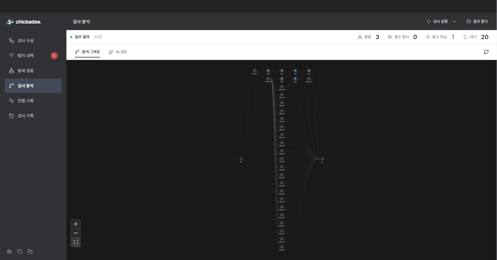

수집과 분석 과정을 진행 순서에 따라 확인합니다.


</details>

### 3.2 문자 위장 및 은닉 탐지

Chromium이 렌더링한 DOM, 계산된 CSS와 좌표를 분석합니다. 광고 문맥과 아래 기법을 함께 확인하고, 원문과 요소 위치를 저장합니다.

| 탐지 유형 | 결과 코드 | 분석 항목 |
| --- | --- | --- |
| 닮은꼴 문자 | `HOMOGLYPH` | 키릴 문자, 전각 문자, 유사 문자와 숫자를 섞은 표기 |
| 자모 분해 | `JAMO` | 분리된 한글 자모와 태그 사이로 나뉜 문구 |
| 투명 문자 | `TRANSPARENT` | 투명한 글자색, 요소와 상위 요소의 투명도, 배경과 같은 글자색 |
| 화면 밖 은닉 | `OFFSCREEN` | 음수 좌표, 극소 글자, 잘린 영역과 숨겨진 요소 |


그림 2. 로컬 검증 페이지에서 확인한 4종 탐지 결과. 위장 기법이 없는 일반 광고 문맥은 별도 항목으로 기록합니다.

<details>
<summary><strong>오프라인 데모 검사</strong></summary>

내장 예제로 탐지 기법과 처리 단계를 확인할 수 있습니다.

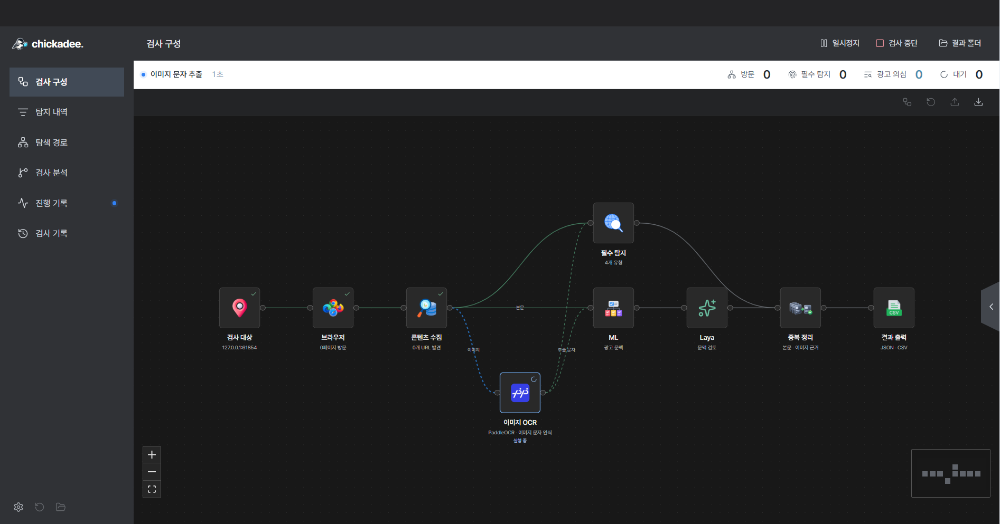

</details>

### 3.3 이미지 문자 추출

이미지 속 한국어 문구를 PaddleOCR로 읽고 원본 이미지, 인식 문구, 글자 위치와 인식 신뢰도를 연결합니다. 줄을 선택하면 해당 영역이 강조됩니다. 같은 이미지의 반복 처리는 캐시로 줄이고, 인식 실패와 생략은 처리 결과에 따로 남깁니다.


그림 3. 한국어 검증 이미지의 문자 추출과 줄 단위 위치 표시.

웹페이지 검사 외에 이미지와 텍스트를 직접 분석하는 로컬 백엔드 도구 `content.analyze`도 제공합니다. 직접 입력한 문자와 이미지에서 읽은 문구를 출처별로 구분해 반환합니다. [직접 분석 호출 및 반환 형식](docs/content-analysis.md)

<details>
<summary><strong>줄 선택 및 이미지 처리 통계</strong></summary>

인식한 줄을 선택해 원본 이미지의 위치와 신뢰도를 확인합니다.


문자 인식, 판독 실패, 오류와 생략을 구분합니다.

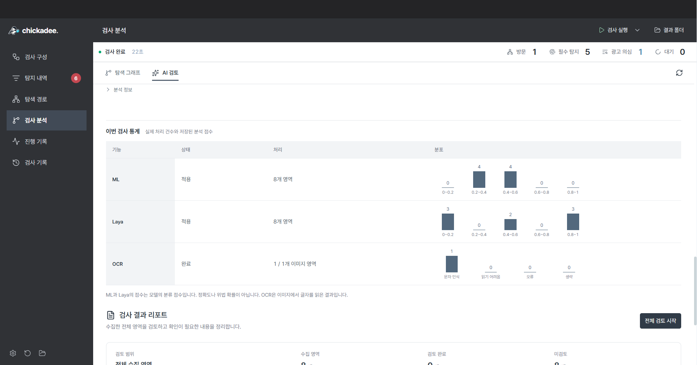

</details>

### 3.4 광고 문맥 분석 및 Laya 연결

본문과 OCR 문구를 로컬 ML로 분석해 검토 우선순위를 제공합니다. 문자 특징은 TF-IDF와 RF로 처리하고, 이미지 특징의 분석 결과는 별도 보조 신호로 제공합니다. 모델 점수는 정확도나 법적 위반 확률과 구분합니다.

검사 분석 화면에서는 ML 처리 영역 수와 점수 분포, OCR 처리와 실패 건수를 확인합니다. 적용된 모델이 없는 Laya 항목은 **미적용**으로 표시합니다.

Laya는 **로컬 CPU 문맥 검토 단계**로 연결되어 있습니다. 독립 평가를 확인한 모델 묶음과 실행 환경을 명시적으로 설치한 경우 기존 OCR과 ML 다음에 실행합니다. 별도 API 호출이나 가중치 자동 다운로드는 없습니다. 현재 기본 배포본에는 새 Laya 가중치를 포함하지 않았으며, 학습 결과와 적용 상태를 구분합니다. [Laya 연결 및 모델 설정](docs/content-analysis.md#로컬-laya-연결)


그림 4. 검사별 처리 건수와 점수 분포. 학습 평가 수치는 [학습 및 평가](#7-학습-및-평가)에 별도로 정리했습니다.

### 3.5 Groq 추가 검토

사용자가 **전체 검토 시작**을 누르면 Groq가 수집된 원문과 분석 정보를 조회합니다. 광고 의심 문맥을 우선 검토하고, 판단에 필요한 내용이 부족하면 같은 사이트에서 이미 발견한 링크를 제한적으로 추가 확인합니다. AI 의견은 기존 탐지 결과와 사용자의 검토 상태를 덮어쓰지 않습니다.

| 항목 | 기본 설정 |
| --- | --- |
| AI 서비스 | Groq |
| 모델 | `openai/gpt-oss-20b` |
| 사용량 한도 | 검사당 누적 6회, 24,000토큰 |
| 키 입력 | 앱 AI 설정의 비밀번호 입력란 |
| 외부 설정 | `GROQ_API_KEY`가 있는 파일을 `--groq-env-file`로 지정 |
| 의견 보존 | 검토한 항목, 미검토 항목, 부족한 자료와 누적 사용량 구분 |

키는 검사 결과와 보고서에 저장하지 않습니다. Groq를 실행하지 않아도 기본 검사, OCR, ML과 로컬 보고서를 사용할 수 있습니다. [키 설정 및 사용량 관리](docs/inspection-agent.md)


그림 5. 수집 항목별 AI 의견과 원문 조회. 예시 실행은 5회 요청과 6,165토큰을 사용했으며, 5개 항목 중 검토 2개와 미검토 3개를 구분했습니다.

<details>
<summary><strong>AI 키 설정 및 사용량</strong></summary>

키는 비밀번호 입력으로 표시합니다. 외부 파일에서 등록한 키도 등록 상태로 확인할 수 있습니다.


검사별 요청 횟수와 토큰 사용량을 누적 관리합니다.


</details>

### 3.6 결과 검토 및 기록 관리

탐지 항목에서 원문, URL, CSS 선택자와 촬영 화면을 확인합니다. 검색과 필터, 항목별 검토 상태, 메모와 일괄 처리를 지원합니다. 저장한 검사 기록은 사이트를 다시 방문하지 않고 열 수 있습니다.

스크린샷은 관찰 당시 화면을 저장합니다. 투명하거나 화면 밖에 있는 글자는 이미지에 보이지 않을 수 있으므로 원문과 CSS를 함께 확인합니다. 보고서에는 검사 상태, 처리 통계, 검토 의견과 촬영 화면을 담습니다.


그림 6. 검사 브라우저에서 전달한 페이지 미리보기.

<details>
<summary><strong>원문 조회 및 화면 확대</strong></summary>

선택한 항목의 원문, URL과 요소 위치를 확인합니다.


탐지 시점에 저장한 스크린샷을 확대합니다.


검사 중인 페이지의 미리보기도 확대할 수 있습니다.

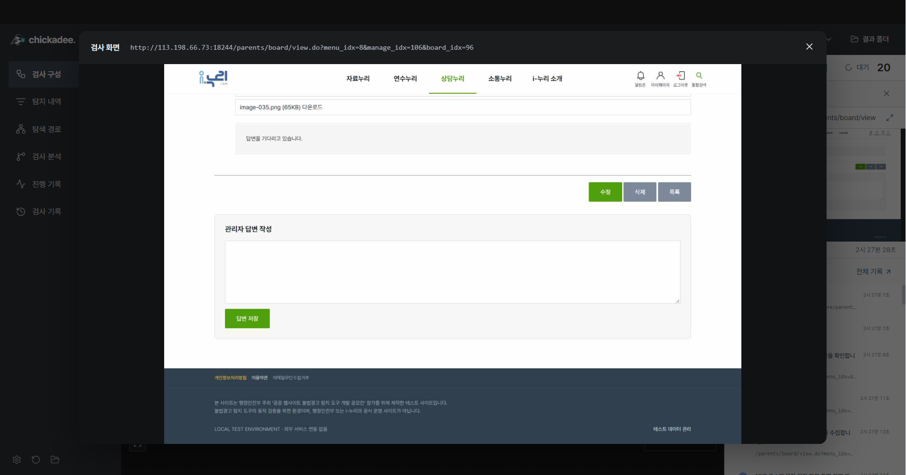

</details>

<details>
<summary><strong>검토 상태 저장 및 기록 복원</strong></summary>

항목별 검토 상태와 메모를 저장합니다.

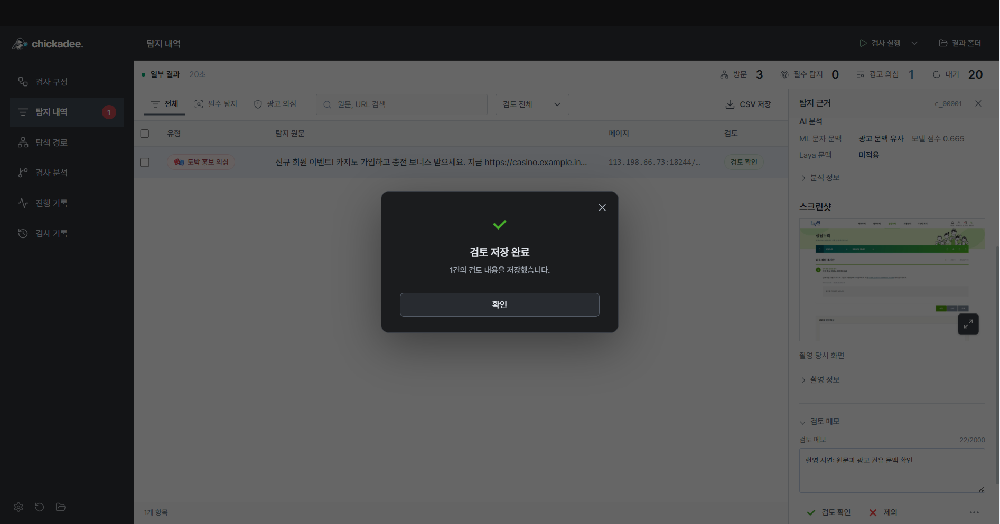

선택한 항목은 일괄 처리할 수 있습니다.

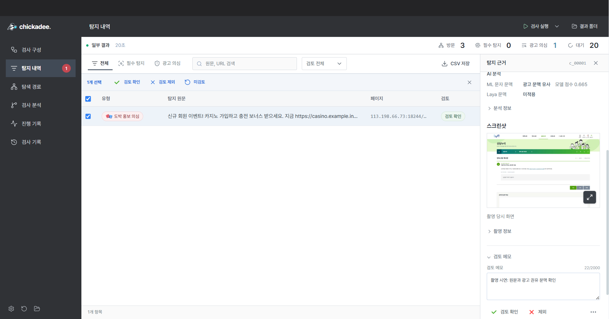

검사 기록에서 저장한 실행을 다시 엽니다.


저장한 검토 상태와 메모를 복원합니다.

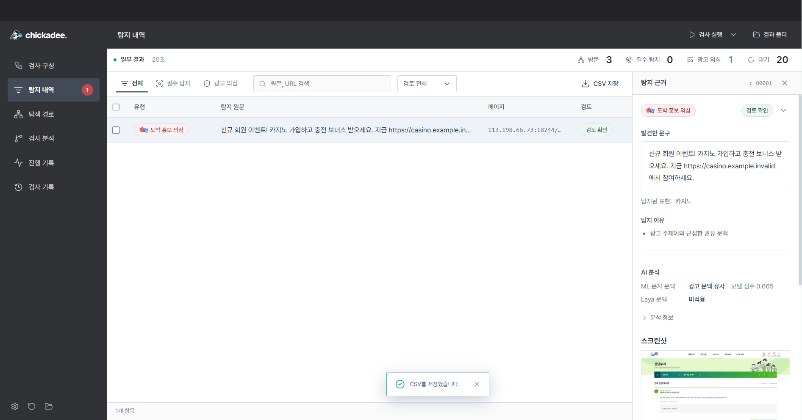

</details>

[화면별 기능 안내](docs/features.md) | [보고서 HTML 예시](docs/assets/demos/sample-report.html) | [CSV 예시](docs/assets/demos/sample-results.csv)

### 3.7 운영 설정 및 편의 기능

실행 환경에 맞는 검사 모드와 저장 위치를 설정하고, 완료 알림과 예약 검사를 사용할 수 있습니다. 예약 검사는 앱이 실행 중일 때 동작하며, 외부 알림 채널은 사용자가 연결해야 합니다. 빠른 명령과 단축키로 화면 이동과 반복 작업을 줄일 수 있습니다.

<details>
<summary><strong>실행 환경 및 검사 설정</strong></summary>


</details>

<details>
<summary><strong>알림 및 예약 검사</strong></summary>

완료 알림과 채널별 보고서 전송 조건을 설정합니다.


저장한 검사 구성을 일정에 맞춰 실행합니다.


</details>

<details>
<summary><strong>단축키, 업데이트 및 빠른 명령</strong></summary>

자주 쓰는 명령의 단축키를 설정합니다.


새 릴리스와 다운로드 상태를 확인합니다.


Ctrl K로 화면 이동과 결과 관련 명령을 검색합니다.


</details>

## 4. 기능 시연

**GIF 01. 탐색 흐름 확인**

관측한 페이지와 수집 상태를 연결하고, 긴 그래프를 확대하거나 이동합니다.


**GIF 02. 이미지 문자 추출**

한국어 검증 이미지에서 추출한 문구와 글자 영역을 확인합니다.


**GIF 03. 원문 및 촬영 화면 확인**

항목의 원문과 위치를 확인하고 스크린샷을 확대합니다.

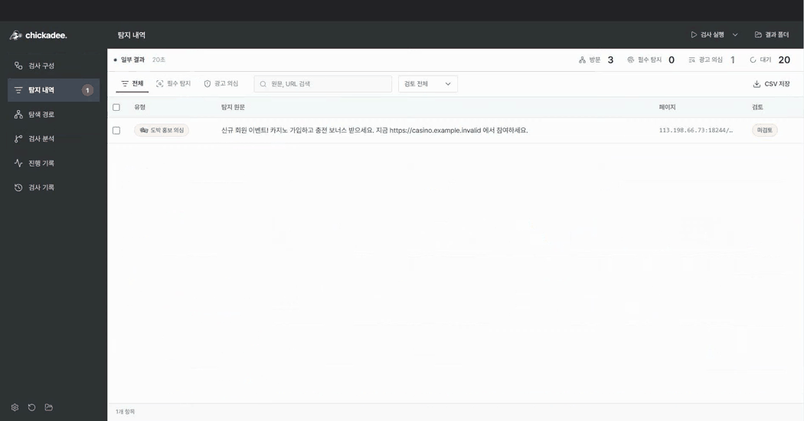

**GIF 04. 처리 통계 및 AI 검토**

ML과 OCR 처리 통계, Groq 검토 의견과 연결 설정을 확인합니다.


**GIF 05. 검토 저장 및 결과 내보내기**

미리보기 확대, 검토 메모, 일괄 선택, CSV 저장과 기록 복원을 확인합니다.

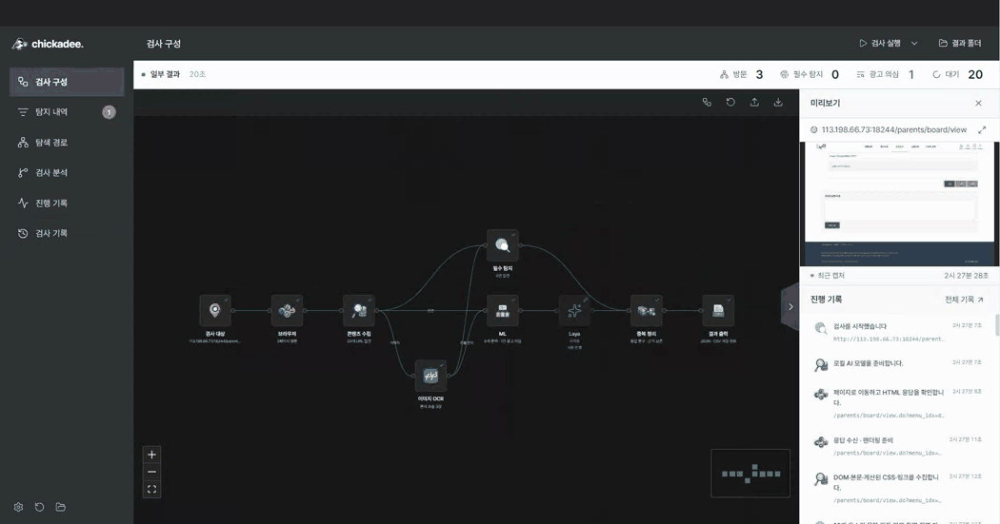

[전체 화면 및 녹화 파일](docs/features.md)

## 5. 출력 파일

기본 저장 위치는 **`문서/Chickadee/results/<실행별 폴더>/`**입니다. 저장 위치를 바꾸면 해당 경로 아래에 실행별 폴더를 생성합니다. 앱의 **결과 폴더**에서 실제 위치를 확인할 수 있습니다.

| 파일 | 저장 내용 |
| --- | --- |
| `result.json` | 문자 위장과 은닉 4종의 탐지 결과. `meta`와 `findings` 구조 |
| `result_extra.json` | 추가 광고 문맥. `ETC`와 `extra_finding`으로 유형 구분 |
| `result.csv` | 위장 및 은닉 탐지와 추가 광고 문맥을 고정 17개 칼럼으로 출력 |
| `scan-report.json` | 실행 상태, 수집 범위, 오류, DOM과 CSS, OCR과 로컬 분석 |
| `review.json` | 사용자 검토 상태와 메모 |
| `agent.json` | Groq 검토 의견, 추가 탐색 내역과 누적 사용량 |
| `events.jsonl` | 검사 진행 이벤트 |
| `review-report.html` | 스크린샷을 포함한 독립 실행형 보고서 |
| `review-report.md` | 보고서의 Markdown 원본 |
| `evidence/` | 관찰 당시 촬영한 화면 이미지 |

JSON은 UTF-8, BOM 없이 저장합니다. `result.json`은 모든 페이지의 탐지 항목을 `findings` 배열 하나에 담으며, 0건일 때도 빈 배열을 생성합니다. 검출 단위는 `(url, location, technique)`이고 원문은 정규화 전 상태로 보존합니다. 같은 요소에서 두 기법을 발견하면 별도 항목으로 기록합니다.

<details>
<summary><strong>result.json 예시</strong></summary>

```json
{
  "meta": {
    "topic": "TOPIC",
    "entry_url": "https://example.org/board",
    "started_at": "2026-10-23T10:00:00+09:00",
    "finished_at": "2026-10-23T10:00:12.500+09:00",
    "elapsed_sec": 12.5
  },
  "findings": [
    {
      "id": "f_00001",
      "url": "https://example.org/board/view?id=1",
      "is_violation": true,
      "location": "article.post > p:nth-of-type(1)",
      "evidence_text": "ｃａｓｉｎｏ 가입 보너스 지급",
      "technique": "HOMOGLYPH"
    }
  ]
}
```

iframe의 위치는 `iframe[src="절대주소"] >>> 내부 선택자`로 기록합니다. `is_violation`은 탐지 결과 형식의 필드이며, 일반 광고 문맥이나 AI 의견만으로 법적 위반을 확정하지 않습니다.

</details>

HTML 보고서는 인터넷 없이 열 수 있으며 브라우저 인쇄에서 PDF로 저장할 수 있습니다. 일부 결과나 중단된 실행에서는 완료 여부와 미검토 수를 함께 확인합니다.

<details>
<summary><strong>보고서 저장 및 CSV 내보내기</strong></summary>

HTML과 Markdown으로 보고서를 보존합니다.

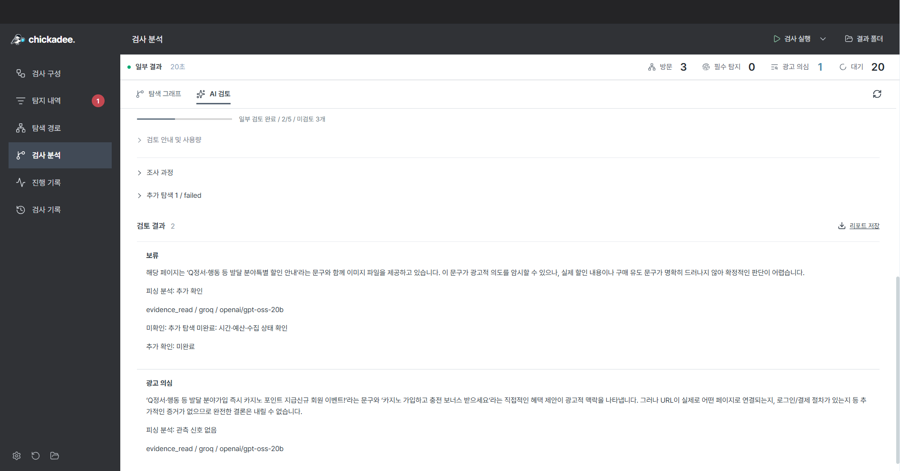

표 형식으로 활용할 결과는 고정 17개 칼럼의 CSV로 내보냅니다.

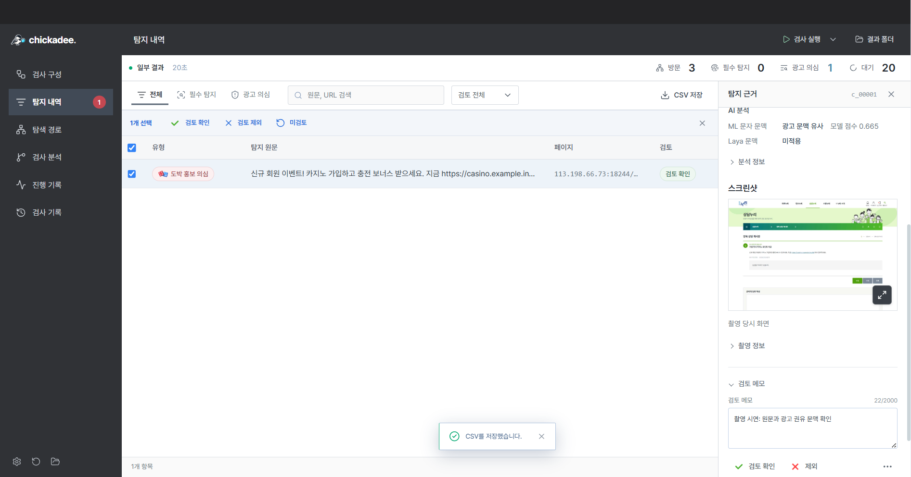

</details>

<details>
<summary><strong>보고서 전체 화면</strong></summary>


</details>

[결과 규격 및 CSV 칼럼](docs/result-format.md) | [JSON Schema](schemas/result.schema.json)

## 6. 데이터 구성

### 6.1 공개 자료

한국어 광고 문맥, 이미지 문자 인식과 이미지 주제 분류를 구분해 자료를 정리했습니다. 공개 자료의 기존 라벨과 실제 광고의 의미를 확인한 뒤 용도에 맞게 사용했습니다.

| 자료 | 용도 | 구분 |
| --- | --- | --- |
| [한국어 YouTube 봇 댓글](https://huggingface.co/datasets/MisileLab/youtube-bot-comments-v2) | 성인 및 도박 홍보성 댓글과 정상 댓글의 문맥 분류 | MIT. 아래 문자 모델 비교에 활용 |
| [한국어 스미싱 메시지](https://huggingface.co/datasets/jmjmjm3/kor-smishing-message) | 사기와 광고 문구 후보 수집 및 중복 정리 | CC BY-NC-SA 4.0. 아래 비교 평가에는 미포함 |
| [Ko-ToxicWebQ](https://github.com/kimjeyoung/Ko-ToxicWebQ) | 한국어 유해 주제와 변형 표현 참고 | 실제 광고 정답과 구분 |
| [Adult content dataset](https://figshare.com/articles/dataset/Adult_content_dataset/13456484) | 선정적 이미지의 주제 분류 실험 | MIT. 문자 인식 및 위법 광고 라벨과 구분 |
| [PaddleOCR](https://github.com/PaddlePaddle/PaddleOCR) | 공식 한국어 사전 학습 모델과 문자 추출 | 앱의 한국어 OCR에 활용 |
| 관계 기관 공개 사례 | 광고 캡처와 광고 인용문, 정상 보도 문맥 정리 | 광고 영역과 기사 본문을 구분 |

### 6.2 내용 유형 14종

아래 유형을 사례 수집과 검토 기준으로 사용합니다. 현재 자동 탐지는 문자 위장과 은닉 4종, 광고 문맥 분석을 중심으로 제공하며, 14종 전체에 대한 지도 학습 분류 성능은 별도 검증 대상입니다.

| 번호 | 내용 유형 | 정리한 자료와 문맥 |
| ---: | --- | --- |
| 1 | 선정적 또는 음란 광고 | 한국어 홍보 댓글과 이미지 주제 사례 |
| 2 | 도박 광고 | 가입, 보상과 연락을 유도하는 홍보 댓글 |
| 3 | 마약 광고 | 공개 단속 사례의 판매 및 연락 유도 문구 |
| 4 | 불법 금융 광고 | 대출과 투자 권유, 공개 금융 광고 사례 |
| 5 | 사기 광고 | 스미싱 후보와 사칭 및 거래 유도 문구 |
| 6 | 불법 의료 광고 | 관계 기관의 의료 광고 공개 사례 |
| 7 | 불법 의약품 광고 | 의약품 판매 유도와 공개 단속 사례 |
| 8 | 불법 유흥 광고 | 공개 자료의 예약, 가격 및 연락 유도 문구 |
| 9 | 청소년 유해 광고 | 청소년 대상 대리입금 등 공개 사례 |
| 10 | 불법 구인 및 구직 광고 | 취업 사기와 모집 유도 문구 |
| 11 | 개인정보 불법 거래 광고 | 개인정보 DB 거래 광고 캡처 |
| 12 | 불법 상품 거래 광고 | 위조 상품과 위조 신분증 판매 인용문 |
| 13 | 허위 및 과장 광고 | 공정거래위원회와 식약처의 공개 사례 |
| 14 | 불법 디지털 광고 | 디지털 공격 의뢰와 저작권 침해 서비스 사례 |

### 6.3 자료 정리 및 분할

1. **출처 보존**: 원본 URL, 파일 해시, 수집 경로와 기존 라벨의 의미 기록.
2. **입력 구분**: 실제 광고, 보도 속 광고 인용, 정상 보도와 합성 문구 분리.
3. **중복 정리**: 원문 정규화 중복과 유사 문구 확인, 같은 문서와 캠페인 단위 관리.
4. **평가 분리**: 학습, 검증, 보정과 테스트 분할을 고정하고 원문과 분할 해시 보존.
5. **독립 자료 보존**: 새로 확보한 독립 평가 자료를 학습과 임계값 조정에서 제외.
6. **모델 적용 판단**: 비교 결과와 실제 입력에서의 동작을 확인한 뒤 배포 여부 결정.

스미싱 추가 자료는 18,270행에서 정규화 중복 4,058행을 정리하고, 라벨 충돌과 짧은 문구 등의 41개 그룹을 격리했습니다. 남은 14,171개는 수집 후보이며, 스미싱 라벨을 14종 광고 정답으로 바꾸지 않았습니다. 한 문서에서 잘라낸 이미지 영역도 각각의 독립 광고로 세지 않습니다.

원본 학습 자료와 실험 체크포인트는 저장소에 포함하지 않습니다. 앱 실행에 필요한 배포 모델과 고지는 패키지에 포함하며, 각 공개 자료의 이용 조건을 따릅니다.

## 7. 학습 및 평가

### 7.1 한국어 문맥 분류

실제 문구 440건과 합성 문구 49건을 사용해 모델을 비교했습니다. 아래 수치는 정상 댓글과 홍보성 봇 댓글로 구성한 **고정 개발 평가셋 118건**의 결과입니다. 14종 위법 광고 판별이나 독립 운영 환경의 정확도와 구분합니다.

| 모델 | 정확도 | Macro F1 | 홍보 문맥 재현율 | 정상 문맥 오탐률 |
| --- | ---: | ---: | ---: | ---: |
| RF | 86.44% | 0.8619 | 72.88% | 0.00% |
| RF 데이터 보강 | 87.29% | 0.8708 | 74.58% | 0.00% |
| BERT 본체 미세조정 | 88.98% | 0.8892 | 81.36% | 3.39% |
| Laya 본체 미세조정 | 95.76% | 0.9576 | 93.22% | 1.69% |


새로 확보한 5개 출처의 광고 7건과 정상 보도 5건은 별도 진단 자료로 보존했습니다. RF 기본 모델은 광고 0/7건, 데이터 보강 모델은 1/7건을 탐지했습니다. 7건 중 6건은 원문 외의 출처 문맥이 필요한 사례여서, 이 결과는 새로운 유형의 문맥 부족을 확인하는 데 활용합니다. Laya 본체 미세조정 모델의 독립 평가 결과는 아직 확보하지 않았습니다.

### 7.2 OCR 문자 추출

실제 이미지 16장의 고정 문자 영역 43개에서 기존 모델과 추가 학습 모델을 비교했습니다. 단일 시각 전사 기준의 라틴 문자 파일럿이며 한국어 영역은 포함하지 않습니다.

| 모델 | 문자 오류 | 문자 오류율 CER | 적용 상태 |
| --- | ---: | ---: | --- |
| 기존 OCR | 13 / 1,229자 | 1.06% | 기존 한국어 모델 유지 |
| 추가 학습 OCR | 36 / 1,229자 | 2.93% | 배포 미적용 |


한국어는 별도의 검증 이미지로 문구 추출, 글자 좌표와 앱 표시를 확인했습니다. 이 기능 검증을 한국어 전체 데이터의 인식 정확도로 환산하지 않습니다.

### 7.3 배포 모델 및 실행 검증

| 구성 | 현재 배포 상태 |
| --- | --- |
| 한국어 PaddleOCR | 기존 사전 학습 모델 유지 |
| 로컬 ML | 기존 RF 모델 유지 |
| BERT와 Laya | 비교 실험 결과 보존, 신규 가중치 미적용 |
| Groq | 사용자 설정 후 선택 실행 |

[Windows 패키지 검증](https://github.com/orqan137/chickadee_studio/actions/runs/39824971344)에서 ZIP 압축 해제, 앱 실행, 한국어 OCR, 이미지 없는 처리 경로, 로그인 재개와 AI 키 등록을 확인했습니다. 배포 파일의 체크섬과 포함 모델을 검증하고, Windows에서 디버그 옵션 없이 실행되는 것도 확인했습니다. 보고서 저장과 다시 열기, 검토 상태 복원과 CSV 내보내기를 검증했습니다.

[평가 수치 및 분할 해시](docs/assets/evaluation/metrics.json) | [테스트 안내](docs/validation.md)

## 8. 개발 환경

개발 기준은 **Python 3.12와 Node.js 24**입니다. Windows 실행본 사용자는 개발 환경을 설치할 필요가 없습니다.

```sh
git clone https://github.com/orqan137/chickadee_studio.git
cd chickadee_studio
```

<details>
<summary><strong>Windows PowerShell</strong></summary>

```powershell
py -3.12 -m venv .venv
.\.venv\Scripts\python.exe -m pip install -r requirements-dev.txt
.\.venv\Scripts\python.exe scripts/prepare_ocr_models.py
$env:PLAYWRIGHT_BROWSERS_PATH = '0'
.\.venv\Scripts\python.exe -m playwright install chromium --only-shell
cd desktop
npm ci
npm run build
npm start
```

패키징은 저장소 루트에서 `./scripts/build-desktop.ps1`로 실행합니다. 출력 경로는 `artifacts/electron-<버전>/win-unpacked/`입니다.

</details>

<details>
<summary><strong>macOS</strong></summary>

```sh
python3.12 -m venv .venv
.venv/bin/python -m pip install -r requirements-dev.txt
.venv/bin/python scripts/prepare_ocr_models.py
PLAYWRIGHT_BROWSERS_PATH=0 .venv/bin/python -m playwright install chromium --only-shell
cd desktop
npm ci
npm run build
npm start
```

Electron과 Python 가상환경의 CPU 아키텍처를 맞춰 사용합니다.

</details>

화면과 앱 셸은 `desktop/`, 검사 엔진은 `chickadee/`, 출력 규격은 `schemas/`에 있습니다. 평가 도표는 `scripts/render_evaluation_charts.py`로 공개 수치에서 다시 생성할 수 있습니다.

## 9. 문서 및 기여

| 문서 | 내용 |
| --- | --- |
| [사용설명서](docs/quickstart-windows.md) | 설치, 실행과 결과 위치 |
| [기능 안내](docs/features.md) | 화면별 기능, GIF와 녹화 파일 |
| [앱 사용법](docs/desktop.md) | 검사, 기록과 설정 |
| [구현 구조](docs/architecture.md) | 화면, 엔진과 분석 모듈 |
| [출력 규격](docs/result-format.md) | JSON 필드와 CSV 칼럼 |
| [AI 설정](docs/inspection-agent.md) | Groq 설정, 추가 탐색과 사용량 |
| [테스트 안내](docs/validation.md) | 자동 테스트와 패키지 검증 |
| [기여 안내](CONTRIBUTING.md) | 이슈 제보, 개발과 PR 절차 |

버그 제보와 기능 제안은 [GitHub Issues](https://github.com/orqan137/chickadee_studio/issues)에서 받습니다. 재현 가능한 예제와 실행 환경을 함께 남겨 주세요. API 키와 로그인 정보가 포함된 자료는 게시하지 않습니다.

## 10. 라이선스

소스코드는 [Apache License 2.0](LICENSE)으로 공개합니다. 외부 라이브러리, 글꼴과 모델의 출처 및 라이선스는 [외부 구성요소 안내](docs/third-party-notices.md)에서 확인할 수 있습니다.
