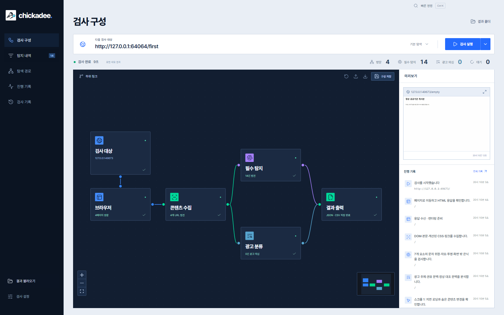
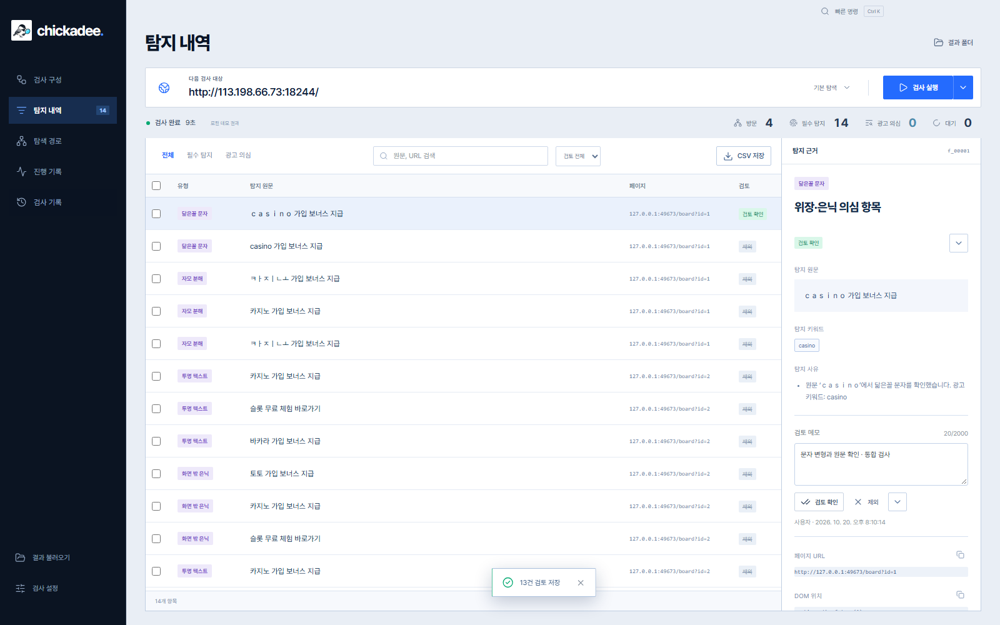
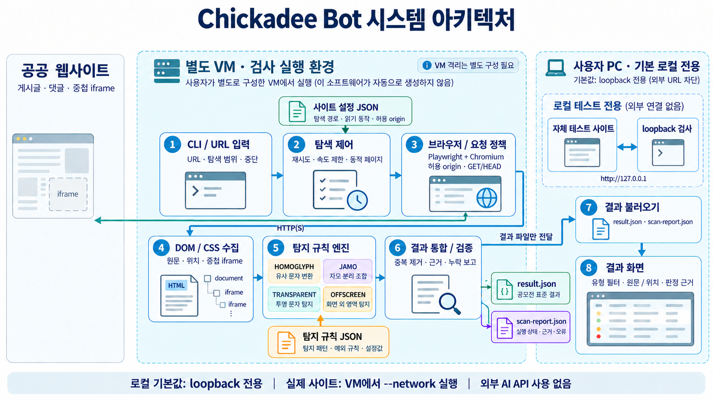

## Chickadee Studio


공공 웹사이트의 광고 의심 요소를 검사하는 **Electron 기반 Windows 앱**입니다. 노드를 연결해 검사 구성을 바꾸고, 실제 검사 화면·방문 경로·HTTP 응답·판정 근거를 확인합니다. 필수 4종 결과는 `result.json`, 전체 내역은 고정 17칼럼 CSV와 보고서로 저장합니다.

**[Windows v0.6.2 다운로드](https://github.com/orqan137/chickadee_Bot/releases/tag/v0.6.2)** → ZIP 전체 압축 해제 → `Chickadee.exe` 실행. Python·Node.js·Docker 설치는 필요하지 않습니다. 외부 URL은 기본 허용이며 Chromium과 검사 프로그램을 함께 제공합니다. [Windows 빠른 실행](docs/quickstart-windows.md) · [데스크톱 앱](docs/desktop.md) · [디자인 기준](DESIGN.md)

## 다운로드하고 바로 실행하기 — Windows 앱

**배포 패키지에는 앱과 검사 프로그램·Chromium이 모두 들어 있습니다.** Windows x64 PC에서 압축을 풀고 실행하면 URL 입력·실제 검사·결과 조회·JSON/CSV 저장을 바로 사용할 수 있습니다. Python, Node.js, Docker, 개발 도구 설치나 빌드 명령은 필요하지 않습니다.

1. **[Chickadee Studio 0.6.2 Windows ZIP 다운로드](https://github.com/orqan137/chickadee_Bot/releases/download/v0.6.2/Chickadee-Studio-0.6.2-win-x64.zip)**를 누릅니다. 배포 페이지에서 받는 경우 Assets의 `Chickadee-Studio-0.6.2-win-x64.zip`을 선택합니다.
2. 다운로드한 ZIP을 원하는 폴더에 **전체 압축 해제**합니다.
3. `Chickadee-0.6.2` 폴더 안의 **`Chickadee.exe`를 더블클릭**합니다.
4. 검사할 URL을 입력하고 **검사 실행**을 누릅니다. 먼저 동작을 확인하려면 **데모 검사**를 누릅니다.

결과는 앱에서 바로 확인하고, **결과 폴더** 버튼으로 저장된 파일을 엽니다. 기본 저장 위치는 `문서/Chickadee/results` 아래 실행별 폴더입니다. 사용자가 선택한 사이트를 검사하려면 인터넷 연결이 필요하며, 로컬 데모는 오프라인으로 실행할 수 있습니다.

`Chickadee.exe`와 `resources` 등 동봉 파일은 같은 배포 폴더에 유지합니다. 이동하거나 팀원에게 전달할 때도 폴더 전체를 사용하세요. 현재 배포는 Windows x64 프리릴리스이며, 배포 인증서 서명은 포함하지 않았습니다. 0.6.2 패키지는 GitHub Windows 환경에서 실제 앱 실행·데모 통합 검사를 통과했습니다. 사용자 PC의 Device Guard 등 보안 정책에 따른 실행 제한과 남은 한계는 [검증 기록](docs/validation.md)을 참고하세요.

행정안전부·한국지능정보사회진흥원의 **2026 공공 웹사이트 불법광고 탐지 도구 개발 공모전**을 목표로 개발하고 있습니다. 현재 필수 4종의 규칙 기반 탐지·화면·파일 출력을 구현했으며, 최종 제출본 수준의 탐지 성능 검증은 남아 있습니다.

## 데스크톱 작업 흐름

- **검사 구성:** 대상 → 브라우저 → 콘텐츠 수집 → 필수 탐지/광고 분류 → 결과 출력. 포트 연결·해제와 하위 링크 설정이 실제 실행에 적용됩니다.
- **검사 제어:** 현재 페이지를 마친 뒤 일시정지, 남은 주소부터 재개, 중단 후 일부 결과 저장을 지원합니다. 선택한 페이지 하나만 재검사할 수 있습니다.
- **검토 작업:** 미검토·검토 확인·제외, 2,000자 메모와 최대 500건 일괄 처리. 재불러오기 시 유지하며 필수 원문 결과는 변경하지 않습니다.
- **빠른 조작:** 검사 실행과 보조 작업을 분리한 펼침 메뉴, `Ctrl K` 빠른 명령, 키보드 메뉴 이동, 검사 설정·저장 폴더 기억.
- **실시간 화면:** 실제 Chromium 화면, 현재 URL, 단계와 HTTP 응답을 표시합니다. 대상 HTML을 Electron 표시 창에 삽입하지 않습니다.
- **탐지 내역:** 필수 탐지·광고 의심 필터, 원문 검색, 근거 패널, CSV 저장을 제공합니다.
- **탐색 경로:** 방문·대기 목록, 발견 출처, 응답 코드·추출 수치·시간을 확인합니다.
- **검사 기록:** 실행마다 별도 폴더, 전체 이벤트 로그, 마지막 검사 화면과 최근 30개 실행을 보관합니다.
- **디자인:** 로컬 Pretendard, 선명한 블루·짙은 네이비·최소 라운드와 README 기반 새 로고를 적용했습니다.
- **에이전트 확장:** 실행 ID·JSON Schema·이벤트 순번을 가진 로컬 도구 9개를 제공합니다. 현재 AI 제공자는 연결하지 않았습니다. [연동 규격](docs/agent-extension.md)을 참고하세요.



화면 이미지는 로컬 UI와 실제 Python 검사 브리지를 연결해 데모를 실행하고 저장된 기록을 다시 연 소스 통합 검사 화면입니다. 미리보기·확대·기록 복원·CSV·재시작 설정 복원을 확인했습니다. 최종 Windows 파일의 실행 검증 상태는 [검증 기록](docs/validation.md)에 구분했습니다.

## 구현한 탐지 기능

| 필수 탐지 유형 | 코드 | 처리하는 사례 |
| --- | --- | --- |
| 닮은꼴 글자 위장 | `HOMOGLYPH` | 전각·키릴·일부 그리스 문자·숫자, `ㅋr지노` 혼합 표기와 광고 문맥의 `CΟΜ` |
| 자모 분해 | `JAMO` | 호환·결합 자모, 여러 인라인 태그에 분리된 문구 |
| 투명 텍스트 | `TRANSPARENT` | 투명색, 요소·조상 opacity, 단색 배경과 같은 글자색 |
| 화면 밖 은닉 | `OFFSCREEN` | 음수 문서 좌표, 0~1px 글자, 작은 상자+overflow:hidden, display:none·visibility:hidden |

- 실제 Chromium 렌더링의 DOM·계산된 CSS를 검사합니다. 사용자의 Chrome 프로필·탭은 사용하지 않습니다.
- 같은 사이트의 링크·게시글 쿼리를 탐색하고, 지연 로딩·제한된 스크롤·설정한 읽기용 컨트롤을 처리합니다.
- 허용 origin 안의 중첩 iframe을 검사합니다. 외부 출처는 사이트 설정에서 명시해야 하며 차단·누락은 보고서에 남깁니다.
- 네트워크 일시 오류·5xx 재시도와 페이지 간 간격·실행 한도를 적용합니다. 429 수신 시 해당 origin의 재시도와 새 요청을 중단합니다.
- 키워드 안에서 실제로 변형된 문자를 추적합니다. 관계없는 전각·자모 문자가 있다고 위장으로 판정하지 않습니다.
- 탐지 규칙·사이트 설정을 JSON으로 교체할 수 있습니다. 규칙·설정 파일의 코드는 실행하지 않습니다.
- 원문·URL·유형·요소 위치를 화면에서 조회하고 유형별로 필터링합니다.
- `result.json`을 UTF-8(BOM 없음)으로 저장합니다. 중첩 기법은 기법별로 나누고 동일 검출을 중복 저장하지 않습니다.
- 중단·시간/페이지 한도·수집 오류를 화면과 `scan-report.json`에 표시합니다.
- 결과를 다시 불러와 필터링하고, 키워드 일치·CSS 속성·프레임·읽기 동작 근거를 확인할 수 있습니다.
- 로컬 데모 사이트를 내장합니다. 외부 API·API 키·GPU 없이 작동합니다.

0.4.0에서는 카드형 대시보드·원문/URL 검색·정렬·판정 근거/원시 JSON/실행 기록 탭·CSV 내보내기를 제공합니다. 혼합 `ㅋrㅈi노`, 주소 구분점, 파일명·기사 인용·문단 경계의 오탐을 보강했습니다. 위장·은닉이 없는 카지노·대출·투자·구매 유도는 별도 검토 후보로 분류합니다. 후보에 필수 4종 코드를 임의로 붙이지 않습니다.

0.4.2에서는 게시판·상세 글을 일반 메뉴보다 먼저 방문하고, `data-url`·`data-href`·단순 `location.href` 주소를 추가로 수집합니다. 목록과 상세 글의 같은 광고 후보는 합치며, 실행 기록과 보고서에서 링크 발견 수·요소 수·방문 시간·본문 선택자 일치 여부를 확인할 수 있습니다. [실제 테스트 페이지 비교와 한계](docs/performance.md)를 참고하세요.



## Dots 조사 자료 반영

최신 v4는 **광고 의심 55건(직접 조사 50·문헌 5), 정상 23건**, 총 78건입니다. 이전 43건을 유지하고 신규 35건을 추가했으며, 원본·해시와 검토 분류를 함께 보존했습니다. 숫자 장식·NFD 파일명은 확정 기법과 구분하고, A019는 제외했습니다. [v4 정리·제작용 JSON 안내](docs/research-v4.md)를 확인하세요.

0.3.0에는 최초 조사본을 바탕으로 혼합 문자·부분 자모 탐지, 정상 교재·지명·브랜드·기사 인용 오탐 억제, 스크롤 좌표 보정, 작은 클리핑 상자 판정과 429 중단 정책을 반영했습니다. v4 자료 추가가 새 패턴 전체의 검출 성공을 뜻하지는 않습니다.

원본의 `dom_verified`는 정적 HTML 확인을 뜻하며 계산된 CSS·화면 검증과 다릅니다. 원본 HTML을 실행하지 않고 새로 작성한 로컬 fixture로 동작을 검증합니다. 실제 사이트 정확도는 아직 측정하지 않았습니다. [자료·코드 반영 내역과 한계](docs/research-integration.md)를 확인하세요.

## Electron 앱 실행과 빌드

Windows 배포 폴더 전체를 해제하고 `Chickadee.exe`를 실행합니다. URL 입력 후 **검사 실행**, 합성 사례는 **데모 검사**를 사용합니다. 데모의 예상 필수 탐지는 14건입니다.

개발 환경은 Windows x64, Python 3.12, Node.js 24 기준입니다. 루트의 Python 가상환경과 Chromium을 준비한 후:

```powershell
cd desktop
npm ci
npm run build
npm start
```

루트의 `scripts/build-desktop.ps1`로 검사 프로그램과 Electron Windows 앱을 함께 빌드합니다. 생성 위치는 `artifacts/electron-0.6.2/win-unpacked/Chickadee.exe`입니다. `resources/engine`을 포함한 폴더 전체를 배포합니다. [개발·배포·검증 절차](docs/desktop.md)를 확인하세요.

## Python CLI·Tkinter 호환 화면

빌드된 Windows 패키지가 있으면 **`ChickadeeBot` 폴더 전체**를 해제하고 `ChickadeeBot.exe`를 실행합니다. **로컬 데모 준비 → 탐지 시작**을 누르면 예상 14건과 원문·위치를 확인할 수 있습니다.

소스 실행은 Windows 11 x64, Python 3.12 기준입니다.

```powershell
py -3.12 -m venv .venv
.\.venv\Scripts\python.exe -m pip install -r requirements.txt
$env:PLAYWRIGHT_BROWSERS_PATH = '0'
.\.venv\Scripts\python.exe -m playwright install chromium --only-shell
.\.venv\Scripts\python.exe -m chickadee --demo
```

CLI 데모와 테스트:

```powershell
.\.venv\Scripts\python.exe -m chickadee --demo --cli --output-dir artifacts/demo
.\.venv\Scripts\python.exe -m pip install -r requirements-dev.txt
.\.venv\Scripts\python.exe -m unittest discover -s tests -v
```

Windows 빌드:

```powershell
powershell -NoProfile -ExecutionPolicy Bypass -File scripts/build.ps1
```

생성 위치는 `dist/ChickadeeBot/ChickadeeBot.exe`입니다. 브라우저와 런타임이 포함된 `_internal` 폴더도 함께 배포해야 합니다. 소스코드만 clone한 경우 설치·빌드 절차가 필요합니다.

## 결과 파일

개발 소스에는 **검사 분석 → 탐색 그래프 / 변경 비교 / Groq 검토**가 추가되었습니다. [사용법·Groq 전송 범위·사용량 한도](docs/inspection-agent.md)를 확인하세요. 외부 유료 API는 Groq만 사용하며 자동 호출은 없습니다. 기존 배포 ZIP은 해당 기능을 포함하도록 다시 빌드해야 합니다.

새 앱은 문서 폴더의 `Chickadee/results/실행별폴더`에 저장합니다. **검사 설정**에서 변경할 수 있습니다. Python CLI와 Tkinter 호환 화면은 기존 `results` 경로와 `--output-dir`를 사용합니다.

| 파일 | 내용 |
| --- | --- |
| `result.json` | `meta`와 `findings`, 필수 4종 평가용 결과. 0건도 빈 배열 저장 |
| `scan-report.json` | 완료·일부 결과·중단·실패 상태, 점검 페이지, 오류·한도, 결과 파일 해시 |
| `result.csv` | 필수 기법·광고 의심 후보를 고정된 17개 칼럼으로 저장. [칼럼 정의](docs/result-format.md) |

데스크톱 앱은 실행별 폴더에 저장합니다. Python CLI에서 같은 출력 경로를 재사용하면 이전 파일을 교체합니다. **일부 결과나 실패를 0건 정상 완료로 해석하지 마세요.** 일반 광고 후보는 보고서 `ad_candidates`와 CSV에 저장하며, 위장·은닉이 없는 문구는 필수 `result.json`에 넣지 않습니다. `result_extra.json`은 생성하지 않습니다.

## 실제 사이트 검사

GUI에서는 URL을 입력하고 점검 시작을 누릅니다. CLI도 기본적으로 외부 URL을 허용하며 기존 `--network` 옵션은 호환성을 위해 유지합니다.

```powershell
# CLI 사용 예시
.\.venv\Scripts\python.exe -m chickadee --scan 'https://www.korea.kr/' --network --profile profiles/public-site.json --max-pages 3 --timeout 120 --interval 2 --output-dir artifacts/scan
```

저장한 결과는 화면의 **결과 불러오기**로 다시 확인합니다. 이 기능은 출처 사이트에 접속하거나 HTML을 실행하지 않습니다. 자세한 [사용 절차와 실행 제한](docs/manual.md)을 확인하세요.

## 아키텍처



[구조·실행 경계 설명](docs/architecture.md) · [편집 가능한 원본](docs/assets/architecture.drawio)

## 문서와 구조

| 경로 | 내용 |
| --- | --- |
| `chickadee/` | 탐지 규칙, 브라우저 탐색, 화면, CLI, 로컬 데모 |
| `tests/` | 실제 Chromium 통합 검사와 화면·출력 검사 |
| [실행·빌드·사용설명서](docs/manual.md) | 설치, 배포, 저장 경로, 오류·제한 |
| [탐색 성능·한계](docs/performance.md) / [실제 결과](examples/test-site-2026-10-20/) | 첫 결과·방문 범위 비교, 실제 CSV·보고서, 다음 개선 |
| [검증 기록](docs/validation.md) | 통과한 테스트·배포 확인과 미검증 항목 |
| [Windows 빠른 실행](docs/quickstart-windows.md) / [저장 칼럼](docs/result-format.md) | 실행 파일·고정 CSV 17개 칼럼 |
| [Dots 자료 반영](docs/research-integration.md) / [조사 원본](research/README.md) | 관찰 수준·근거·코드 변경·회귀 검사 |
| [요구사항](docs/requirements.md) | 모집요강과 필수 스키마·평가 조건 |
| [개발 계획](docs/development-plan.md) | 구현 상태와 다음 작업 |
| [ML·에이전트 일반화 설계](docs/ml-agent-generalization.md) / [오프라인 대조](research/ml-review/2026-10-21/) | 참고 프로젝트·전달 리뷰 검토, 현재 규칙 대조, Groq 연결 제안과 검증 기준 |
| [제출 체크리스트](docs/submission-checklist.md) | 신청 서류·실행 파일·최종 검증 |
| [결과 스키마](schemas/result.schema.json) | 자체 개발용 검증 규칙, 공식 배포 파일 아님 |
| [검출 예시](examples/result.sample.json) / [0건 예시](examples/result.empty.json) | 형식 설명용 가상 데이터 |
| [모의 웹 제작 명세 JSON](examples/mock-site-spec.json) | 필수 4종·복합·정상 대조군 30개, 동적 탐색 시나리오 6개 |
| [모의 웹 실제 내용 JSON](examples/mock-site-content.json) | 최신 원문 78건·배치 예시 79개, 실제 문구·CSS·코드 포인트·검토 분류 |
| [v4 조사 정리](docs/research-v4.md) | 신규 35건·제외·중복·확인 수준, 재생성·검증 절차 |
| [외부 구성요소](docs/third-party-notices.md) | 사용 도구와 라이선스 확인 경로 |

## 현재 한계

규칙 기반 도구로 오탐과 누락이 있으며 법적 판단을 대신하지 않습니다. 읽기 버튼은 사이트별 선택자 설정이 필요하고, POST 기반 댓글 API·로그인·이미지 OCR·모든 CSS 은닉 기법·무한 스크롤 전체 수집·Shadow DOM은 지원하지 않습니다. 자체 테스트의 14건 검출은 실제 사이트나 비공개 평가셋의 정확도를 뜻하지 않습니다. 사용자 PC 보호 요청에 따라 실제 의심 사이트의 브라우저 검증은 실행하지 않았습니다.

접수 마감은 제공된 모집요강 기준 **2026년 10월 23일 18:00**입니다. Windows 11 실행 파일, 전체 소스코드, 실행·빌드 매뉴얼, 사용설명서와 신청 서류를 함께 준비해야 하며 최종 일정·운영 조건은 주최 측 공지를 확인해야 합니다. 근거는 「공공 웹사이트 불법광고 탐지 도구 개발 공모전 모집요강」(2026년 9월)이며 PDF 원문과 개인정보 서류는 저장소에 포함하지 않았습니다.
